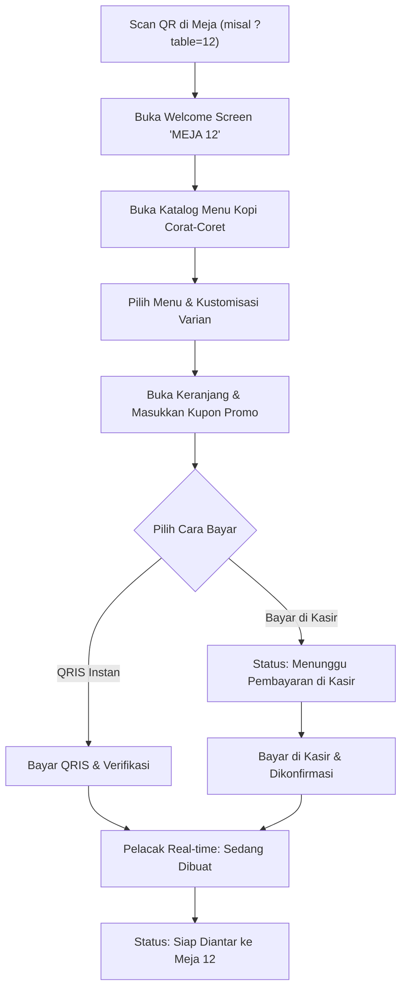
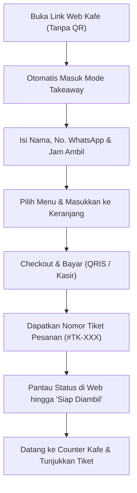

# Product Requirements Document (PRD)
## Kopi Corat-Coret – Self-Order Web App ("Sketchbook Kafe")

- **Version:** 1.0.0
- **Status:** Approved / Ready for Extraction
- **Author:** Product Manager
- **Date:** 2026-10-23
- **Design Reference:** [`desain-web/sketchbook_kafe/DESIGN.md`](file:///d:/Projects/stud-web/desain-web/sketchbook_kafe/DESIGN.md)

---

## 1. Overview
**Kopi Corat-Coret Self-Order Web App** adalah aplikasi web pemesanan mandiri (*self-ordering*) ramah sentuhan (mobile-first) untuk kafe bertema "Sketchbook Kafe". Aplikasi ini memungkinkan pelanggan memesan menu kafe langsung dari smartphone tanpa perlu mengunduh aplikasi native. 

Sistem mendukung dua pintu masuk utama:
1. **Dine-In:** Membaca parameter meja secara otomatis saat pelanggan memindai QR Code di meja (misal: `?table=12`).
2. **Takeaway:** Pelanggan yang mengakses link langsung tanpa QR meja otomatis diarahkan ke mode pesanan bawa pulang (*Takeaway / Pick-up*) dengan estimasi waktu pengambilan.

Sistem dirancang dengan estetika visual **Tactile / Skeuomorphic Sketchbook** (doodle organik, washi tape, marker shadow, kertas bertekstur hangat) yang memikat, intuitif, dan cepat digunakan.

---

## 2. Product Type & Audit Scope

- **Product Type:** `web app` (Mobile-First Responsive Web Application)

### Applicable Checks Probed:
- **Auth and Sessions:** Manajemen sesi ganda (*Guest Session* tanpa login vs *Member Account* dengan registrasi/login sederhana berbasis data lokal).
- **Authorization per Resource:** Pelanggan hanya dapat melihat status dan struk pesanan milik sesi mereka sendiri.
- **Data Model & Migrations:** Struktur skema data di `localStorage` (Menu, Keranjang, Pesanan Aktif, Riwayat, Akun Member, dan Kupon Diskon).
- **Accessibility:** Kontras warna teks espresso (`#4A2C17`) pada latar krem susu (`#FFF9EF`), touch target minimum 44x44px untuk kenyamanan sentuh di layar HP.
- **Responsive Layout:** Dioptimalkan secara presisi untuk tampilan mobile portrait (viewport 360px - 430px) dan responsif saat dibuka di tablet / desktop.
- **Browser Support:** Kompatibel dengan peramban mobile modern (Mobile Safari iOS, Google Chrome Android, Samsung Internet, in-app browser Instagram/QR Scanner).
- **Page-Load Budget:** Pemuatan awal di bawah 2 detik pada jaringan 4G/Wi-Fi kafe, memanfaatkan aset web ringan dan Google Fonts teroptimasi.
- **SEO for Public Pages:** Minimal untuk halaman katalog publik Takeaway (meta tag dasar dan OpenGraph preview untuk tautan media sosial).

### Skipped Checks (with Justification):
- `binary size`: Diabaikan karena aplikasi dijalankan langsung via browser web tanpa paket instalasi binary native (APK/IPA).
- `offline sync`: Diabaikan karena pemesanan dan pelacakan status pesanan secara esensial memerlukan koneksi internet aktif ke kafe.

---

## 3. Goals and Objectives

### Business Goals
- Mengurangi antrean di kasir fisik pada jam sibuk (*peak hours*) hingga 60%.
- Meniadakan kesalahan pencatatan pesanan (kustomisasi gula, level pedas, jenis susu) dengan transfer pesanan digital langsung.
- Meningkatkan nilai rata-rata transaksi (*Average Order Value*) melalui visualisasi katalog makanan pendamping dan add-on yang menarik.

### User Goals
- Pelanggan dapat memesan langsung dari tempat duduk tanpa perlu berdiri mengantre di kasir.
- Pelanggan luar dapat memesan Takeaway sebelum tiba di kafe sehingga pesanan sudah siap begitu mereka sampai.
- Transparansi total atas rincian biaya, pajak PB1, diskon kupon, dan estimasi waktu peracikan.

---

## 4. Scope

### In Scope (MVP Initial Release)
- **Deteksi Meja Otomatis & Pemisahan Mode:**
  - Parameter URL `?table=XX` mengunci mode Dine-In.
  - URL tanpa parameter otomatis masuk ke mode Takeaway (input nama, no. WA, estimasi jam ambil).
- **Katalog Menu Interaktif:** Kategori menu (Kopi Susu, Manual Brew, Makanan Berat, Camilan, Non-Kopi), pencarian instan, dan badge promo.
- **Kustomisasi Menu (Drawer Modal):** Pilihan varian dingin/panas, level gula, jenis susu (Fresh Milk, Oat Milk, Almond Milk), level pedas, dan catatan barista.
- **Keranjang & Struk Belanja:** Nota sementara bergaya struk kasir berporos robek, validasi kupon promo (`SKETCHKOPI`), perhitungan PB1 (10%), stepper jumlah item.
- **Metode Pembayaran:**
  - QRIS Instan (tampilan QR dinamis dengan timer hitung mundur).
  - E-Wallet Langsung.
  - Bayar di Kasir (pesanan berstatus *Menunggu Pembayaran di Kasir*, baru diproses setelah dibayar).
- **Pelacak Pesanan Real-Time:** Status bertahap (*Menunggu Pembayaran / Diterima -> Sedang Dibuat -> Siap Diambil/Diantar*).
- **Autentikasi Dual:** Opsi *Guest Checkout* (cepat) dan *Akun Member* (simpan profil & riwayat transaksi).
- **Penyimpanan Lokal:** Seluruh state persisten disimpan di `localStorage` klien.

### Out of Scope (Excluded from MVP)
- Integrasi Payment Gateway API pihak ketiga live dengan webhook bank (menggunakan simulasi transaksi QRIS & kasir pada rilis awal).
- Pengiriman notifikasi SMS / WhatsApp Business API gateway berbayar (pelanggan memantau status langsung via layar web).
- Modul Kitchen Display System (KDS) terpisah untuk staf dapur (fokus utama adalah pengalaman sisi pelanggan; simulasi pergantian status pesanan disediakan di layar tracker).
- Input nomor meja manual untuk Dine-In tanpa QR (Dine-in wajib via scan QR; akses tanpa QR diarahkan ke Takeaway).

---

## 5. User Personas

### 1. Rian (24) – Mahasiswa / Remote Worker (Dine-In)
- **Karakteristik:** Datang ke kafe membawa laptop, langsung mencari meja kosong dan colokan listrik.
- **Kebutuhan:** Tidak ingin kehilangan tempat duduknya saat memesan kopi.
- **Perilaku:** Scan QR di mejanya, memesan Es Kopi Susu dengan Oat Milk Less Sugar, bayar pakai QRIS, dan memantau status pesanan dari layar ponsel sambil mulai bekerja.

### 2. Nadia (28) – Pegawai Kantoran yang Sibuk (Takeaway)
- **Karakteristik:** Membutuhkan sarapan & kopi pagi sebelum masuk kantor di gedung sebelah.
- **Kebutuhan:** Memesan sebelum tiba di kafe agar tidak terlambat.
- **Perilaku:** Membuka link dari bio Instagram kafe saat di perjalanan, memilih Takeaway, mengisi nomor WhatsApp, membayar via QRIS, dan mengambil pesanan begitu tiba di counter pick-up.

---

## 6. Functional Requirements

### Modul A: Inisialisasi & Akses Meja
- **FR-1:** Sistem harus mendeteksi parameter query URL `table` (misal: `?table=12`). Jika terdeteksi, sistem otomatis mengunci sesi sebagai **Dine-In (Meja 12)** dan menampilkan banner penyambutan sesuai desain [01_welcome_meja_12](file:///d:/Projects/stud-web/desain-web/01_welcome_meja_12).
- **FR-2:** Jika sistem diakses tanpa parameter `table`, sistem harus mengunci sesi sebagai **Takeaway** dan menampilkan form informasi pengambilan (Nama Pemesan, Nomor WhatsApp, dan Estimasi Waktu Pengambilan).
- **FR-3:** Sistem harus menampilkan informasi koneksi Wi-Fi kafe (SSID & Password) dan kode kupon promo aktif pada halaman awal.

### Modul B: Autentikasi & Akun Pengguna
- **FR-4:** Sistem harus menyediakan alur **Guest Checkout** yang memungkinkan pemesanan instan tanpa perlu mendaftar atau memasukkan kata sandi.
- **FR-5:** Sistem harus menyediakan alur **Akun Member** opsional yang memungkinkan pengguna untuk:
  - Registrasi akun sederhana (Nama, No. WhatsApp, PIN/Password).
  - Masuk (*Login*) dan keluar (*Logout*).
  - Menyimpan profil dan melihat riwayat pesanan terdahulu dari `localStorage`.

### Modul C: Katalog Menu & Pencarian
- **FR-6:** Sistem harus menampilkan daftar menu terbagi dalam kategori: *Semua*, *Kopi Susu*, *Manual Brew*, *Makanan Berat*, *Camilan*, dan *Non-Kopi*.
- **FR-7:** Sistem harus menyediakan input pencarian (*search bar*) real-time yang memfilter nama atau deskripsi menu seketika.
- **FR-8:** Setiap kartu menu harus menampilkan foto, nama, label kategori/badge promo (misal: *Favorit*, *Spesial*), harga dalam format Rupiah, dan tombol *Tambah*.

### Modul D: Kustomisasi Menu (Drawer Sheet)
- **FR-9:** Ketika menu dengan opsi varian dipilih, sistem harus membuka modal drawer kustomisasi sesuai desain [03_kustomisasi_menu](file:///d:/Projects/stud-web/desain-web/03_kustomisasi_menu).
- **FR-10:** Kustomisasi minuman harus mendukung:
  - Pilihan Suhu: *Dingin (Ice)* / *Panas (Hot)*.
  - Level Gula (*Sugar Level*): *Normal (100%)*, *Less Sugar (50%)*, *No Sugar (0%)*.
  - Pilihan Susu: *Fresh Milk (+Rp 0)*, *Oat Milk (+Rp 6.000)*, *Almond Milk (+Rp 6.000)* dengan penambahan harga otomatis.
- **FR-11:** Kustomisasi makanan harus mendukung level pedas atau opsi telur (setengah matang / matang).
- **FR-12:** Sistem harus menyediakan input teks bebas untuk *Catatan Khusus untuk Barista/Koki*.
- **FR-13:** Sistem harus menyediakan stepper pengatur jumlah item (*Quantity*) dan kalkulasi harga total varian sebelum ditambahkan ke keranjang.

### Modul E: Keranjang Belanja & Nota Struk
- **FR-14:** Sistem harus menampilkan ringkasan item di keranjang dengan rincian varian terpilih, tombol ubah varian, tombol hapus item, dan stepper kuantitas.
- **FR-15:** Sistem harus mendukung input kupon diskon (contoh: `SKETCHKOPI` untuk diskon 10%) dan memvalidasinya secara real-time.
- **FR-16:** Sistem harus menghitung rincian biaya: Subtotal, Potongan Kupon Diskon, Pajak Restoran PB1 (10%), dan Total Akhir Pembayaran.
- **FR-17:** Tampilan nota keranjang harus mengikuti gaya nota kertas bergaris perforasi robek sesuai desain [04_keranjang_struk](file:///d:/Projects/stud-web/desain-web/04_keranjang_struk).

### Modul F: Pembayaran
- **FR-18:** Sistem harus menyediakan 3 pilihan metode pembayaran:
  1. *QRIS Instan* (BCA, GoPay, OVO, ShopeePay, Dana).
  2. *E-Wallet Langsung* (Deeplink simulasi).
  3. *Bayar di Kasir* (Tunai, Kartu Debit, atau EDC).
- **FR-19:** Jika memilih *QRIS Instan*, sistem harus menampilkan kode QR interaktif lengkap dengan hitung mundur kedaluwarsa (15 menit) dan tombol unduh/simpan QR sesuai desain [05_pembayaran_qris](file:///d:/Projects/stud-web/desain-web/05_pembayaran_qris).
- **FR-20:** Jika memilih *Bayar di Kasir*, pesanan harus dibuat dengan status awal **Menunggu Pembayaran di Kasir** disertai instruksi untuk menunjukkan kode pesanan ke kasir.

### Modul G: Pelacakan Pesanan Real-Time
- **FR-21:** Setelah pesanan terkonfirmasi, sistem harus mengalihkan pengguna ke halaman pelacak pesanan sesuai desain [06_pelacak_pesanan_real_time](file:///d:/Projects/stud-web/desain-web/06_pelacak_pesanan_real_time).
- **FR-22:** Pelacak harus menampilkan tahapan status visual:
  - Kasus Bayar di Kasir: *Menunggu Pembayaran di Kasir* -> (Setelah bayar) -> *Pesanan Diterima* -> *Sedang Diracik* -> *Siap Diambil/Diantar*.
  - Kasus QRIS / Online: *Pesanan Diterima* -> *Sedang Diracik* -> *Siap Diambil/Diantar*.
- **FR-23:** Sistem harus menyediakan tombol simulasi atau kontrol progres status bagi pengguna/penguji untuk melihat perubahan status pesanan secara langsung.
- **FR-24:** Halaman pelacak harus menampilkan rincian nomor meja (atau label Takeaway), nomor antrean pesanan, perkiraan waktu tunggu, dan tombol bantuan staf.

---

## 7. Non-Functional Requirements

- **NFR-1 (Desain & Estetika):** Antarmuka harus 100% konsisten dengan spesifikasi sistem desain [DESIGN.md](file:///d:/Projects/stud-web/desain-web/sketchbook_kafe/DESIGN.md): warna utama `#FFC93C`, tinta espresso `#4A2C17`, latar kertas `#FFF9EF`, tipografi *Epilogue* & *Nunito Sans*, dan bayangan solid marker `3px 3px 0px #4A2C17`.
- **NFR-2 (Performa Responsif):** Waktu respon interaksi klik/sentuh tombol (*First Input Delay*) harus di bawah 100ms dengan efek mikro-animasi tactile bouncer.
- **NFR-3 (Persistensi Data):** State keranjang dan pesanan aktif tidak boleh hilang saat halaman web dimuat ulang (*refresh*), tersimpan aman di `localStorage`.
- **NFR-4 (Validasi Form):** Form nama, nomor telepon, dan kupon harus memiliki validasi pesan error bergaya corat-coret yang ramah dan jelas.
- **NFR-5 (Kompatibilitas Layar):** Tata letak harus fleksibel mulai dari resolusi 320px (perangkat kecil) hingga tablet/desktop (kiosk mode dengan container terpusat yang nyaman).

---

## 8. User Journeys

### Journey 1: Pelanggan Dine-In (Scan QR Meja)

### Journey 2: Pelanggan Takeaway (Pesan Sebelum Tiba)

---

## 9. Success Metrics
- **Order Completion Rate:** > 85% sesi yang menambahkan menu ke keranjang berhasil menyelesaikan pesanan (*place order*).
- **Time to Order:** Rata-rata waktu dari scan QR hingga checkout pesanan selesai < 90 detik.
- **Voucher Utilization:** > 25% pelanggan baru memanfaatkan kode promo `SKETCHKOPI`.
- **Cart Abandonment:** < 15% pada tahap pemilihan pembayaran.

---

## 10. Implementation Timeline (High-Level Milestones)

| Milestone | Target Luaran |
|---|---|
| **M1: Fondasi & Token Desain** | Pengaturan CSS variables, font Epilogue & Nunito Sans, utilitas tactile button, washi tape, dan card container. |
| **M2: Navigasi & Pengalihan Meja/Takeaway** | Router query URL `?table=XX`, layar Welcome Meja, dan form inisialisasi Takeaway. |
| **M3: Modul Katalog & Kustomisasi** | Tampilan katalog menu, search bar, filter kategori, dan modal drawer varian minuman/makanan. |
| **M4: Keranjang, Perhitungan PB1 & Kupon** | Komponen nota struk kasir, validasi kupon diskon, kalkulasi pajak 10%, dan pilihan pembayaran. |
| **M5: Layar Pembayaran & QRIS** | Antarmuka pembayaran QRIS, timer 15 menit, dan alur pembayaran kasir. |
| **M6: Pelacak Pesanan Real-Time & Auth Member** | Pelacak status pesanan bertahap, persistensi `localStorage`, serta modul login/profil member. |
| **M7: Polish & UAT** | Uji coba menyeluruh semua alur pengguna dan verifikasi responsive tablet/mobile. |

---

## 11. Decisions & Rationale

| Keputusan | Pilihan Diterima | Alternatif Ditolak | Alasan & Justifikasi |
|---|---|---|---|
| **Deteksi Dine-In vs Takeaway** | Menggunakan parameter query URL `?table=XX`. Jika tanpa parameter, otomatis mode Takeaway. | Memaksa user mengetik nomor meja secara manual saat Dine-In tanpa QR. | Mengetik nomor meja manual rentan salah input nomor meja orang lain. Jika tanpa QR di meja, lebih aman diarahkan ke Takeaway. |
| **Alur Bayar di Kasir** | Pesanan baru diproses barista **setelah** pembayaran diverifikasi di kasir. | Pesanan langsung diracik sebelum dibayar. | Mencegah risiko pesanan fiktif (*unpaid orders*) yang sudah telanjur dibuat bahan bakunya oleh barista. |
| **Notifikasi Pelanggan** | Pelanggan memantau status secara visual langsung di layar pelacak web. | Integrasi gateway WhatsApp Notification API. | Mengurangi biaya operasional API pihak ketiga dan menjaga alur tetap mandiri di sisi web browser. |
| **Penyimpanan Data MVP** | Menggunakan Browser `localStorage` + JSON mock data. | Menggunakan database server eksternal langsung. | Memungkinkan verifikasi fungsionalitas dan interaksi UI secara cepat, stabil, dan independen tanpa dependensi server awal. |
| **Autentikasi Pengguna** | Menyediakan opsi **Guest Checkout** (utama) dan **Akun Member** (opsional). | Mewajibkan login/daftar akun terlebih dahulu. | Kewajiban registrasi akun dapat meningkatkan friksi (*drop-off*) pelanggan yang hanya ingin pesan kopi dengan cepat. |

---

## 12. Open Questions & Assumptions

- **Asumsi 1:** Perangkat kasir fisik kafe memiliki akses untuk menandai atau memverifikasi nomor pesanan yang berstatus *Menunggu Pembayaran di Kasir* (di MVP disimulasikan via tombol konfirmasi pada status tracker).
- **Asumsi 2:** Pajak restoran (PB1) ditetapkan tetap sebesar 10% dari subtotal setelah dipotong kupon promo, sesuai regulasi daerah standar.
- **Asumsi 3:** Menu dan harga bersifat statis di katalog mock `localStorage` dan dapat diperluas ke API remote di fase lanjutan.
