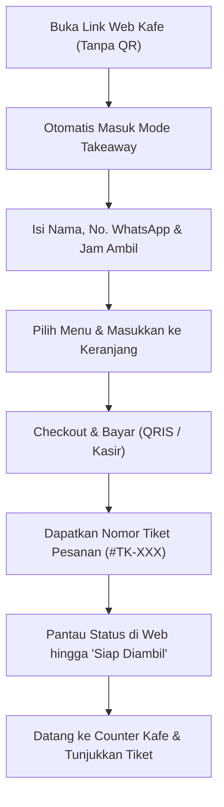
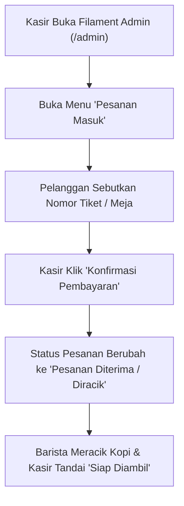

# Product Requirements Document (PRD)
## Kopi Corat-Coret – Self-Order Web App ("Sketchbook Kafe")

- **Version:** 3.0.0 (Updated via CR-001: Laravel + Inertia React + Filament)
- **Status:** Approved / Implementation-Ready
- **Author:** Product Manager
- **Date:** 2026-10-23
- **Baseline Version:** [`PRD.v1.md`](file:///d:/Projects/stud-web/PRD.v1.md)
- **Audit Findings Record:** [`PRD-REVIEW.md`](file:///d:/Projects/stud-web/PRD-REVIEW.md)
- **Change Request Record:** [`changes/CHANGE-REQUEST-001.md`](file:///d:/Projects/stud-web/changes/CHANGE-REQUEST-001.md)
- **Design System Reference:** [`desain-web/sketchbook_kafe/DESIGN.md`](file:///d:/Projects/stud-web/desain-web/sketchbook_kafe/DESIGN.md)

---

## 1. Overview
**Kopi Corat-Coret Self-Order Web App** adalah aplikasi web pemesanan mandiri (*self-ordering*) ramah sentuhan (mobile-first) untuk kafe bertema "Sketchbook Kafe". Aplikasi ini dibangun menggunakan arsitektur modern:
- **Backend:** **Laravel** dengan database relasional (SQLite / MySQL) melalui Eloquent ORM.
- **Frontend Pelanggan:** **Inertia.js + React** yang mengadopsi 100% sistem desain visual **Tactile / Skeuomorphic Sketchbook** (doodle organik, washi tape, marker shadow, kertas bertekstur hangat sesuai [`DESIGN.md`](file:///d:/Projects/stud-web/desain-web/sketchbook_kafe/DESIGN.md)).
- **Panel Admin & Kasir:** **Filament Admin** untuk pengelolaan menu, kategori, stok, serta operasional verifikasi kasir dan pengubahan status pesanan.

Sistem mendukung dua pintu masuk utama bagi pelanggan:
1. **Dine-In:** Membaca parameter meja secara otomatis saat pelanggan memindai QR Code di meja (misal: `?table=12`).
2. **Takeaway:** Pelanggan yang mengakses tautan langsung tanpa parameter meja otomatis diarahkan ke formulir pesanan bawa pulang (*Takeaway / Pick-up*) dengan estimasi waktu pengambilan.

---

## Product Type

- **Type:** `web app` (Fullstack Web Application: Laravel Backend + Inertia React Frontend + Filament Admin)

### Applicable Checks Probed:
- **Auth and Sessions:** Sesi ganda pelanggan (*Guest Checkout* via session/cookies vs *Member Account* via Laravel Auth), serta otentikasi aman untuk admin/kasir via Filament.
- **Authorization per Resource:** Pelanggan hanya dapat melihat status dan struk pesanan milik sesi mereka sendiri; staf kasir/admin mengelola pesanan melalui panel terproteksi.
- **Data Model & Migrations:** Skema database terstruktur via migrasi Laravel (tabel `menus`, `categories`, `orders`, `order_items`, `coupons`, `users`).
- **Accessibility:** Kontras warna teks espresso (`#4A2C17`) pada latar krem susu (`#FFF9EF`), touch target minimum 44x44px untuk kenyamanan sentuh di layar HP.
- **Responsive Layout:** Dioptimalkan secara presisi untuk tampilan mobile portrait (viewport 360px - 430px) pada sisi pelanggan, dan responsif desktop/tablet pada panel Filament Admin.
- **Browser Support:** Kompatibel dengan peramban mobile modern (Mobile Safari iOS, Google Chrome Android, Samsung Internet, in-app browser Instagram/QR Scanner).
- **Page-Load Budget:** Pemuatan awal di bawah 2 detik dengan bundle Vite React dan aset teroptimasi.
- **SEO for Public Pages:** Struktur meta tag OpenGraph dasar untuk pratinjau tautan media sosial.

### Skipped Checks (with Justification):
- `binary size`: Diabaikan karena aplikasi dijalankan langsung via browser web tanpa paket instalasi binary native (APK/IPA).
- `offline sync`: Diabaikan karena alur verifikasi menu, transaksi pembayaran, dan sinkronisasi pesanan ke kasir secara esensial memerlukan koneksi internet aktif ke kafe.

---

## 3. Goals and Objectives

### Business Goals
- Mengurangi antrean di kasir fisik pada jam sibuk (*peak hours*) hingga 60%.
- Meniadakan kesalahan pencatatan pesanan (kustomisasi gula, level pedas, jenis susu) dengan transfer pesanan digital langsung dari smartphone pelanggan ke panel kasir.
- Memberikan kemudahan kontrol penuh bagi owner dan kasir dalam mengubah stok, harga, dan memvalidasi pembayaran melalui panel Filament Admin.
- Meningkatkan nilai rata-rata transaksi (*Average Order Value*) melalui visualisasi katalog makanan pendamping dan add-on yang menarik.

### User Goals
- Pelanggan dapat memesan langsung dari tempat duduk tanpa perlu berdiri mengantre di kasir.
- Pelanggan luar dapat memesan Takeaway sebelum tiba di kafe sehingga pesanan sudah siap begitu mereka sampai.
- Kasir dapat memverifikasi pembayaran pelanggan secara cepat dan transparan melalui panel kasir.

---

## 4. Scope

### In Scope (MVP Initial Release)
- **Deteksi Meja Otomatis & Pemisahan Mode:**
  - Parameter URL `?table=XX` mengunci mode Dine-In.
  - URL tanpa parameter otomatis masuk ke mode Takeaway (input nama, no. WA, estimasi jam ambil).
- **Frontend Pelanggan (Inertia.js + React):**
  - Katalog menu interaktif (filter kategori, pencarian real-time).
  - Modal drawer kustomisasi minuman (suhu, gula, susu, add-on topping/shot ekstra) & makanan (level pedas, telur).
  - Keranjang nota struk robek, perhitungan kupon diskon (`SKETCHKOPI`), dan pajak PB1 (10%).
  - Metode pembayaran: QRIS Instan (timer 15 menit & refresh), E-Wallet langsung, dan Bayar di Kasir.
  - Pelacak pesanan real-time bertahap.
  - Opsi *Guest Checkout* dan registrasi/login akun member.
- **Backend & Database (Laravel 11+):**
  - Database relasional SQLite / MySQL dengan Eloquent ORM & migrasi skema terstruktur.
  - Controller & routing Inertia.js untuk pengiriman data katalog dan pemrosesan checkout.
- **Panel Administrasi & Kasir (Filament Admin):**
  - CRUD Menu & Kategori dengan unggah foto dan kustomisasi varian.
  - Manajemen pesanan masuk: filter pesanan *Menunggu Pembayaran di Kasir*, tombol konfirmasi lunas, dan pengubah status (*Sedang Diracik -> Siap Diambil*).

### Out of Scope (Excluded from MVP)
- Integrasi Payment Gateway API pihak ketiga live dengan webhook bank otomatis (menggunakan simulasi transaksi QRIS & kasir terverifikasi internal).
- Pengiriman notifikasi SMS / WhatsApp Business API gateway berbayar (pelanggan memantau status langsung via layar web).
- Input nomor meja manual untuk Dine-In tanpa QR (Dine-in wajib via scan QR; akses tanpa QR diarahkan ke Takeaway).

---

## 5. User Personas

### 1. Rian (24) – Mahasiswa / Remote Worker (Dine-In)
- **Karakteristik:** Datang ke kafe membawa laptop, langsung mencari meja kosong dan colokan listrik.
- **Kebutuhan:** Tidak ingin kehilangan tempat duduknya saat memesan kopi.
- **Perilaku:** Scan QR di mejanya, memesan Es Kopi Susu dengan Oat Milk Less Sugar, bayar pakai QRIS, dan memantau status pesanan dari layar ponsel sambil mulai bekerja.

### 2. Nadia (28) – Pegawai Kantoran yang Sibuk (Takeaway)
- **Karakteristik:** Membutuhkan sarapan & kopi pagi sebelum masuk kantor di gedung sebelah.
- **Kebutuhan:** Memesan sebelum tiba di kafe agar tidak terlambat.
- **Perilaku:** Membuka link dari bio Instagram kafe saat di perjalanan, memilih Takeaway, mengisi nomor WhatsApp, membayar via QRIS, dan mengambil pesanan begitu tiba di counter pick-up.

### 3. Budi (30) – Kasir & Manajer Operasional Kafe (Filament Admin)
- **Karakteristik:** Bertanggung jawab melayani pembayaran tunai/kartu di kasir dan memantau stok bahan baku.
- **Kebutuhan:** Antarmuka cepat untuk memvalidasi nomor pesanan pelanggan yang bayar di kasir serta menonaktifkan menu yang habis.
- **Perilaku:** Membuka dashboard Filament di laptop kasir, mencari ID pesanan pelanggan, menekan tombol "Konfirmasi Lunas", dan pesanan langsung beralih status ke antrean barista.

---

## 6. Functional Requirements

### Modul A: Inisialisasi & Akses Meja
- **FR-1:** Sistem harus mendeteksi parameter query URL `table` (misal: `?table=12`). Jika terdeteksi, sistem otomatis mengunci sesi sebagai **Dine-In (Meja 12)** dan menampilkan banner penyambutan sesuai desain [01_welcome_meja_12](file:///d:/Projects/stud-web/desain-web/01_welcome_meja_12). *(Priority: Must)*
- **FR-2:** Jika sistem diakses tanpa parameter `table`, sistem harus mengunci sesi sebagai **Takeaway** dan menampilkan form informasi pengambilan (Nama Pemesan, Nomor WhatsApp, dan Estimasi Waktu Pengambilan). *(Priority: Must)*
- **FR-3:** Sistem harus menampilkan informasi koneksi Wi-Fi kafe (SSID & Password) dan kode kupon promo aktif pada halaman awal. *(Priority: Should)*
- **FR-28:** Sistem harus memvalidasi input form Takeaway: Nama minimal 3 karakter, nomor WhatsApp valid format Indonesia (`08...`), dan estimasi waktu pengambilan minimal 10 menit ke depan. *(Priority: Must)*
- **FR-29:** Sistem harus mendukung aksi salin sandi Wi-Fi ke clipboard dengan sekali ketuk (*tap-to-copy*) pada kartu Wi-Fi. *(Priority: Could)*

### Modul B: Autentikasi & Akun Pengguna
- **FR-4:** Sistem harus menyediakan alur **Guest Checkout** yang memungkinkan pemesanan instan tanpa perlu mendaftar atau memasukkan kata sandi. *(Priority: Must)*
- **FR-5:** Sistem harus menyediakan alur **Akun Member** opsional yang memungkinkan pengguna untuk registrasi, login, menyimpan profil, dan melihat riwayat pesanan terdahulu. *(Priority: Should)*

### Modul C: Katalog Menu & Pencarian
- **FR-6:** Sistem harus menampilkan daftar menu terbagi dalam kategori: *Semua*, *Kopi Susu*, *Manual Brew*, *Makanan Berat*, *Camilan*, dan *Non-Kopi*. *(Priority: Must)*
- **FR-7:** Sistem harus menyediakan input pencarian (*search bar*) real-time yang memfilter nama atau deskripsi menu seketika. *(Priority: Must)*
- **FR-8:** Setiap kartu menu harus menampilkan foto, nama, label kategori/badge promo (misal: *Favorit*, *Spesial*), harga dalam format Rupiah, dan tombol *Tambah*. *(Priority: Must)*
- **FR-27:** Sistem harus menyediakan tampilan *Empty State* dan pesan umpan balik ramah bergaya corat-coret ketika pencarian menu tidak menemukan hasil atau saat keranjang masih kosong. *(Priority: Should)*

### Modul D: Kustomisasi Menu (Drawer Sheet)
- **FR-9:** Ketika menu dengan opsi varian dipilih, sistem harus membuka modal drawer kustomisasi sesuai desain [03_kustomisasi_menu](file:///d:/Projects/stud-web/desain-web/03_kustomisasi_menu). *(Priority: Must)*
- **FR-10:** Kustomisasi minuman harus mendukung:
  - Pilihan Suhu: *Dingin (Ice)* / *Panas (Hot)*.
  - Level Gula (*Sugar Level*): *Tanpa Gula (0%)*, *Less Sugar (50%)*, *Normal (100%)*, *Extra Sweet (120%)*.
  - Pilihan Susu: *Fresh Milk (+Rp 0)*, *Oat Milk (+Rp 6.000)*, *Almond Milk (+Rp 7.000)*, *Soy Milk (+Rp 5.000)* dengan penambahan harga otomatis. *(Priority: Must)*
- **FR-25:** Sistem harus mendukung pilihan multi-select *Tambahan Ekstra / Topping & Shot* (misal: Ekstra Espresso Shot +Rp 5.000, Grass Jelly Cincau +Rp 4.000) dengan kalkulasi akumulasi harga instan. *(Priority: Must)*
- **FR-11:** Kustomisasi makanan harus mendukung level pedas atau opsi telur (setengah matang / matang). *(Priority: Should)*
- **FR-12:** Sistem harus menyediakan input teks bebas untuk *Catatan Khusus untuk Barista/Koki*. *(Priority: Should)*
- **FR-13:** Sistem harus menyediakan stepper pengatur jumlah item (*Quantity*) dan kalkulasi harga total varian sebelum ditambahkan ke keranjang. *(Priority: Must)*

### Modul E: Keranjang Belanja & Nota Struk
- **FR-14:** Sistem harus menampilkan ringkasan item di keranjang dengan rincian varian terpilih, tombol ubah varian, tombol hapus item, dan stepper kuantitas. *(Priority: Must)*
- **FR-15:** Sistem harus mendukung input kupon diskon (contoh: `SKETCHKOPI` untuk diskon 10%) dan memvalidasinya secara real-time. *(Priority: Must)*
- **FR-16:** Sistem harus menghitung rincian biaya: Subtotal, Potongan Kupon Diskon, Pajak Restoran PB1 (10%), dan Total Akhir Pembayaran. *(Priority: Must)*
- **FR-17:** Tampilan nota keranjang harus mengikuti gaya nota kertas bergaris perforasi robek sesuai desain [04_keranjang_struk](file:///d:/Projects/stud-web/desain-web/04_keranjang_struk). *(Priority: Must)*

### Modul F: Pembayaran
- **FR-18:** Sistem harus menyediakan 3 pilihan metode pembayaran:
  1. *QRIS Instan* (BCA, GoPay, OVO, ShopeePay, Dana).
  2. *E-Wallet Langsung* (Deeplink simulasi).
  3. *Bayar di Kasir* (Tunai, Kartu Debit, atau EDC). *(Priority: Must)*
- **FR-19:** Jika memilih *QRIS Instan*, sistem harus menampilkan kode QR interaktif lengkap dengan hitung mundur kedaluwarsa (15 menit) dan tombol unduh/simpan QR sesuai desain [05_pembayaran_qris](file:///d:/Projects/stud-web/desain-web/05_pembayaran_qris). *(Priority: Must)*
- **FR-26:** Sistem harus menangani status kedaluwarsa QRIS ketika hitung mundur 15 menit mencapai 00:00 dengan menampilkan status kedaluwarsa dan tombol regenerasi QRIS baru. *(Priority: Must)*
- **FR-20:** Jika memilih *Bayar di Kasir*, pesanan harus dibuat dengan status awal **Menunggu Pembayaran di Kasir** disertai instruksi untuk menunjukkan kode pesanan ke kasir. *(Priority: Must)*

### Modul G: Pelacakan Pesanan Real-Time
- **FR-21:** Setelah pesanan terkonfirmasi, sistem harus mengalihkan pengguna ke halaman pelacak pesanan sesuai desain [06_pelacak_pesanan_real_time](file:///d:/Projects/stud-web/desain-web/06_pelacak_pesanan_real_time). *(Priority: Must)*
- **FR-22:** Pelacak harus menampilkan tahapan status visual:
  - Kasus Bayar di Kasir: *Menunggu Pembayaran di Kasir* -> (Setelah bayar dikonfirmasi) -> *Pesanan Diterima* -> *Sedang Diracik* -> *Siap Diambil/Diantar*.
  - Kasus QRIS / Online: *Pesanan Diterima* -> *Sedang Diracik* -> *Siap Diambil/Diantar*. *(Priority: Must)*
- **FR-23:** Sistem harus menyediakan tombol simulasi atau kontrol progres status bagi pengguna/penguji untuk melihat perubahan status pesanan secara langsung. *(Priority: Should)*
- **FR-24:** Halaman pelacak harus menampilkan rincian nomor meja (atau label Takeaway), nomor antrean pesanan, perkiraan waktu tunggu, dan tombol bantuan staf. *(Priority: Must)*

### Modul H: Panel Admin Filament & Integrasi Backend (Added via CR-001)
- **FR-30:** Sistem harus menyediakan Dashboard Admin berbasis **Filament** untuk mengelola data menu, kategori, harga, kustomisasi varian/add-on, dan tombol toggle status ketersediaan stok (*In Stock / Out of Stock*). *(Priority: Must)*
- **FR-31:** Dashboard Admin Filament harus menyediakan antarmuka pemantauan pesanan kasir, memungkinkan kasir memverifikasi pembayaran pesanan berstatus *Menunggu Pembayaran di Kasir* dan memperbarui status pesanan (*Diterima -> Sedang Diracik -> Siap Diambil*). *(Priority: Must)*
- **FR-32:** Backend Laravel harus menyediakan arsitektur database relasional (SQLite / MySQL) dan controller Inertia.js untuk sinkronisasi katalog menu, pemrosesan transaksi checkout, dan pelacakan status pesanan pelanggan. *(Priority: Must)*

---

## 7. Non-Functional Requirements

- **NFR-1:** Antarmuka pelanggan harus 100% konsisten dengan spesifikasi sistem desain [DESIGN.md](file:///d:/Projects/stud-web/desain-web/sketchbook_kafe/DESIGN.md): warna utama `#FFC93C`, tinta espresso `#4A2C17`, latar kertas `#FFF9EF`, tipografi *Epilogue* & *Nunito Sans*, dan bayangan solid marker `3px 3px 0px #4A2C17`. *(Priority: Must)*
- **NFR-2:** Waktu respon interaksi klik/sentuh tombol (*First Input Delay*) harus di bawah 100ms dengan efek mikro-animasi tactile bouncer. *(Priority: Should)*
- **NFR-3:** State keranjang dan pesanan aktif tidak boleh hilang saat halaman web dimuat ulang (*refresh*), tersinkronisasi aman melalui database Laravel dan sesi browser. *(Priority: Must)*
- **NFR-4:** Form nama, nomor telepon, dan kupon harus memiliki validasi pesan error bergaya corat-coret yang ramah dan jelas. *(Priority: Must)*
- **NFR-5:** Tata letak antarmuka pelanggan harus fleksibel mulai dari resolusi 320px (perangkat kecil) hingga tablet/desktop (kiosk mode dengan container terpusat yang nyaman). *(Priority: Must)*
- **NFR-6:** Mekanisme penyimpanan harus tahan terhadap kegagalan jaringan atau sesi lokal dengan penanganan eror (*try-catch*) yang andal. *(Priority: Must)*

---

## 8. User Journeys

### Journey 1: Pelanggan Dine-In (Scan QR Meja)

### Journey 2: Pelanggan Takeaway (Pesan Sebelum Tiba)

### Journey 3: Kasir Kafe (Filament Admin)

---

## 9. Success Metrics
- **Order Completion Rate:** > 85% sesi yang menambahkan menu ke keranjang berhasil menyelesaikan pesanan (*place order*).
- **Time to Order:** Rata-rata waktu dari scan QR hingga checkout pesanan selesai < 90 detik.
- **Cashier Verification Speed:** Waktu kasir memvalidasi pembayaran di Filament Admin < 5 detik per transaksi.
- **Cart Abandonment:** < 15% pada tahap pemilihan pembayaran.

---

## 10. Implementation Timeline (High-Level Milestones)

| Milestone | Target Luaran |
|---|---|
| **M1: Inisialisasi Laravel & Filament** | Setup proyek Laravel 11+, konfigurasi SQLite/MySQL, instalasi Filament Admin v3, dan migrasi skema tabel dasar. |
| **M2: Setup Inertia.js + React & Token Desain** | Integrasi `@inertiajs/react`, konfigurasi Tailwind & font Epilogue/Nunito Sans sesuai `DESIGN.md`. |
| **M3: CRUD Katalog Menu & Stok Filament** | Resource Filament untuk Manajemen Kategori, Menu, Varian Modifiers, dan toggle status ketersediaan. |
| **M4: Frontend Katalog & Kustomisasi React** | Halaman katalog menu pelanggan, drawer kustomisasi suhu/gula/susu/topping, dan pencarian instan. |
| **M5: Keranjang Struk, Kupon & Checkout** | Komponen struk kasir robek, kalkulasi diskon dan PB1 10%, serta form checkout Takeaway/Dine-In. |
| **M6: Layar Pembayaran (QRIS & Kasir)** | Antarmuka pembayaran QRIS 15 menit dan pembuatan order berstatus *Menunggu Pembayaran di Kasir*. |
| **M7: Operasional Kasir & Pelacak Real-Time** | Fitur validasi kasir di Filament Admin dan halaman pelacak status pesanan bertahap di sisi pelanggan. |
| **M8: Polish & UAT** | Uji coba menyeluruh semua alur pengguna dan verifikasi responsive tablet/mobile. |

---

## 11. Decisions & Rationale

| Keputusan | Pilihan Diterima | Alternatif Ditolak | Alasan & Justifikasi |
|---|---|---|---|
| **Tech Stack (CR-001 Reversal)** | **Laravel + Inertia.js (React) + Filament Admin** | Vanilla JS SPA murni + mock LocalStorage | Menyediakan panel admin dan kasir yang lengkap, aman, dan mudah dikelola tanpa mengorbankan performa interaktif antarmuka pelanggan. |
| **Deteksi Dine-In vs Takeaway** | Menggunakan parameter query URL `?table=XX`. Jika tanpa parameter, otomatis mode Takeaway. | Memaksa user mengetik nomor meja secara manual saat Dine-In tanpa QR. | Mengetik nomor meja manual rentan salah input nomor meja orang lain. Jika tanpa QR di meja, lebih aman diarahkan ke Takeaway. |
| **Alur Bayar di Kasir** | Pesanan baru diproses barista **setelah** pembayaran diverifikasi kasir via Filament. | Pesanan langsung diracik sebelum dibayar. | Mencegah risiko pesanan fiktif (*unpaid orders*) yang sudah telanjur dibuat bahan bakunya oleh barista. |
| **Notifikasi Pelanggan** | Pelanggan memantau status secara visual langsung di layar pelacak web. | Integrasi gateway WhatsApp Notification API. | Mengurangi biaya operasional API pihak ketiga dan menjaga alur tetap mandiri di sisi web browser. |
| **Autentikasi Pengguna** | Menyediakan opsi **Guest Checkout** (utama) dan **Akun Member** (opsional). | Mewajibkan login/daftar akun terlebih dahulu. | Kewajiban registrasi akun dapat meningkatkan friksi (*drop-off*) pelanggan yang hanya ingin pesan kopi dengan cepat. |
| **Pengelolaan Add-on & Topping** | Ditambahkan sebagai requirement resmi (FR-25) mendukung multi-select add-ons. | Menggabungkan add-on ke dalam catatan bebas barista. | Add-on seperti espresso shot dan grass jelly memiliki biaya tambahan yang harus diperhitungkan dalam struk kasir dan subtotal. |
| **Penanganan QRIS Kedaluwarsa** | Ditambahkan requirement regenerasi QRIS baru (FR-26) jika timer mencapai 00:00. | Membiarkan QRIS tetap aktif tanpa batas waktu. | QRIS statis tanpa refresh melanggar standar keamanan transaksi dan membingungkan pelanggan. |
| **Keseragaman Heading PRD** | Menggunakan heading literal `## Product Type` tanpa prefiks angka. | Mempertahankan `## 2. Product Type & Audit Scope`. | Memenuhi kompatibilitas deterministik skrip trace-check otomatis downstream yang memfilter heading `## Product Type`. |

---

## 12. Open Questions & Assumptions

- **Asumsi 1:** Perangkat lokal pengembang atau server kafe memiliki runtime PHP (>= 8.2) dan Composer untuk menjalankan Laravel dan Filament Admin.
- **Asumsi 2:** Pajak restoran (PB1) ditetapkan tetap sebesar 10% dari subtotal setelah dipotong kupon promo, sesuai regulasi daerah standar.
- **Asumsi 3:** Database menggunakan SQLite untuk kemudahan portabilitas instan pada tahap pengembangan lokal dan dapat dialihkan ke MySQL/PostgreSQL saat produksi.
