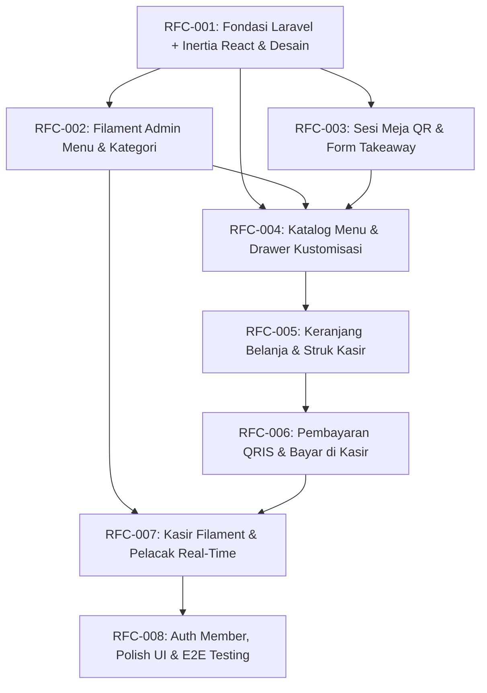

# Implementation Index & Roadmap (RFCS.md)
## Kopi Corat-Coret – Self-Order Web App ("Sketchbook Kafe")

- **Version:** 1.0.0
- **Status:** Ready for Implementation
- **Source Documents:** [`PRD.md`](file:///d:/Projects/stud-web/PRD.md) (v3.0.0), [`FEATURES.md`](file:///d:/Projects/stud-web/FEATURES.md) (v2.0.0), [`RULES.md`](file:///d:/Projects/stud-web/RULES.md) (v2.0.0)
- **Change Request Record:** [`changes/CHANGE-REQUEST-001.md`](file:///d:/Projects/stud-web/changes/CHANGE-REQUEST-001.md)

---

## 1. Overview & Implementation Strategy
Proyek **Kopi Corat-Coret** dipecah menjadi **8 Request for Comments (RFC)** yang terurut secara topologis. Urutan penomoran (001 s/d 008) mencerminkan alur ketergantungan teknis (*dependency graph*) yang valid. Setiap RFC dirancang agar dapat diimplementasikan secara utuh begitu seluruh RFC pendahulunya (*predecessors*) selesai.

Setiap RFC diimplementasikan dengan menjalankan perintah:
```bash
/implement-rfc <rfc-id>
# Contoh: /implement-rfc RFC-001
```

---

## 2. Master RFC Index

| RFC | Title | Features | Depends on | Complexity | Status |
|---|---|:---:|:---:|:---:|:---:|
| **RFC-001** | [Fondasi Proyek Laravel 11, Inertia React, dan Desain Sketchbook Kafe](file:///d:/Projects/stud-web/RFCs/RFC-001-Fondasi-Laravel-Inertia-React.md) | F25, F33 | none | High | Reviewed |
| **RFC-002** | [Dashboard Admin Filament – Manajemen Menu, Kategori, Varian & Stok](file:///d:/Projects/stud-web/RFCs/RFC-002-Dashboard-Admin-Filament-Menu-Kategori.md) | F31 | RFC-001 | Medium | Implemented |
| **RFC-003** | [Alur Sesi, Deteksi Meja QR, dan Formulir Takeaway](file:///d:/Projects/stud-web/RFCs/RFC-003-Alur-Sesi-Meja-QR-Takeaway.md) | F1, F2, F3, F4, F23, F26 | RFC-001 | Medium | Reviewed |
| **RFC-004** | [Penjelajahan Katalog Menu & Drawer Kustomisasi Minuman/Makanan](file:///d:/Projects/stud-web/RFCs/RFC-004-Katalog-Menu-Drawer-Kustomisasi.md) | F5, F6, F7, F8, F9, F10, F11 | RFC-001, RFC-002, RFC-003 | High | Implemented |
| **RFC-005** | [Keranjang Belanja, Kupon Promo & Nota Struk Kasir Robek](file:///d:/Projects/stud-web/RFCs/RFC-005-Keranjang-Belanja-Struk-Kupon.md) | F12, F13, F14, F15 | RFC-004 | Medium | Implemented |
| **RFC-006** | [Alur Pembayaran (QRIS Dinamis 15 Menit & Bayar di Kasir)](file:///d:/Projects/stud-web/RFCs/RFC-006-Alur-Pembayaran-QRIS-Kasir.md) | F16, F17, F18, F19 | RFC-005 | Medium | Implemented |
| **RFC-007** | [Operasional Kasir Filament & Pelacakan Pesanan Real-Time Pelanggan](file:///d:/Projects/stud-web/RFCs/RFC-007-Operasional-Kasir-Filament-Pelacak-Pesanan.md) | F20, F21, F22, F32 | RFC-002, RFC-006 | High | Not started |
| **RFC-008** | [Autentikasi Akun Member, Polish UI & Pengujian E2E](file:///d:/Projects/stud-web/RFCs/RFC-008-Auth-Member-Polish-UI-Testing-E2E.md) | F24 | RFC-007 | Medium | Not started |

---

## 3. Dependency Graph & Implementation Roadmap



### Jalur Kritis (Critical Path)
`RFC-001` ➔ `RFC-002` & `RFC-003` ➔ `RFC-004` ➔ `RFC-005` ➔ `RFC-006` ➔ `RFC-007` ➔ `RFC-008`.

---

## 4. Feature Coverage Verification

- **Must Have (22 Fitur):**
  - F1, F2, F23, F26 ➔ Ditangani di [RFC-003](file:///d:/Projects/stud-web/RFCs/RFC-003-Alur-Sesi-Meja-QR-Takeaway.md)
  - F5, F6, F8, F9, F11 ➔ Ditangani di [RFC-004](file:///d:/Projects/stud-web/RFCs/RFC-004-Katalog-Menu-Drawer-Kustomisasi.md)
  - F12, F13, F14 ➔ Ditangani di [RFC-005](file:///d:/Projects/stud-web/RFCs/RFC-005-Keranjang-Belanja-Struk-Kupon.md)
  - F16, F17, F18, F19 ➔ Ditangani di [RFC-006](file:///d:/Projects/stud-web/RFCs/RFC-006-Alur-Pembayaran-QRIS-Kasir.md)
  - F20, F21 ➔ Ditangani di [RFC-007](file:///d:/Projects/stud-web/RFCs/RFC-007-Operasional-Kasir-Filament-Pelacak-Pesanan.md)
  - F25, F33 ➔ Ditangani di [RFC-001](file:///d:/Projects/stud-web/RFCs/RFC-001-Fondasi-Laravel-Inertia-React.md)
  - F31 ➔ Ditangani di [RFC-002](file:///d:/Projects/stud-web/RFCs/RFC-002-Dashboard-Admin-Filament-Menu-Kategori.md)
  - F32 ➔ Ditangani di [RFC-007](file:///d:/Projects/stud-web/RFCs/RFC-007-Operasional-Kasir-Filament-Pelacak-Pesanan.md)
- **Should Have (6 Fitur):**
  - F3 (Wi-Fi Memo) ➔ [RFC-003](file:///d:/Projects/stud-web/RFCs/RFC-003-Alur-Sesi-Meja-QR-Takeaway.md)
  - F7 (Empty State Menu) ➔ [RFC-004](file:///d:/Projects/stud-web/RFCs/RFC-004-Katalog-Menu-Drawer-Kustomisasi.md)
  - F10 (Kustomisasi Makanan) ➔ [RFC-004](file:///d:/Projects/stud-web/RFCs/RFC-004-Katalog-Menu-Drawer-Kustomisasi.md)
  - F15 (Empty State Cart) ➔ [RFC-005](file:///d:/Projects/stud-web/RFCs/RFC-005-Keranjang-Belanja-Struk-Kupon.md)
  - F22 (Simulasi Progres Status) ➔ [RFC-007](file:///d:/Projects/stud-web/RFCs/RFC-007-Operasional-Kasir-Filament-Pelacak-Pesanan.md)
  - F24 (Riwayat Member) ➔ [RFC-008](file:///d:/Projects/stud-web/RFCs/RFC-008-Auth-Member-Polish-UI-Testing-E2E.md)
- **Could Have (1 Fitur):**
  - F4 (Tap-to-copy Sandi Wi-Fi) ➔ [RFC-003](file:///d:/Projects/stud-web/RFCs/RFC-003-Alur-Sesi-Meja-QR-Takeaway.md)
- **Won't Have (4 Fitur - Ditunda/Out of Scope):**
  - F27 (Live Bank Webhook API)
  - F28 (WA Business API Gateway)
  - F29 (Standalone KDS Tablet Fisik)
  - F30 (Input Meja Manual Tanpa QR)

---

## 5. Cold-Read & Implementation Readiness
Seluruh 8 RFC telah diverifikasi mandiri dan dinyatakan siap implementasi (*Ready for Implementation*). Tidak ada detail arsitektur yang mengambang atau kriteria penerimaan yang ambigu.
