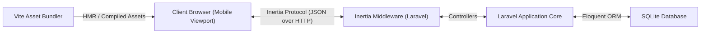

# RFC-001: Fondasi Proyek Laravel 11, Inertia.js React, dan Desain Sketchbook Kafe

**Features**: F25, F33
**Depends on**: none
**Rules**: ARCH-5, ARCH-6, ARCH-7, API-1, UI-1, UI-2, UI-3, UI-4, UI-5, UI-6, CODE-1, CODE-4
**Complexity**: High

---

## 1. Summary
RFC ini meletakkan fondasi arsitektur aplikasi monolit modern menggunakan **Laravel 11+** di backend, **Inertia.js + React 19** di frontend pelanggan, serta integrasi token sistem desain tactile "Sketchbook Kafe" yang didefinisikan dalam [`desain-web/sketchbook_kafe/DESIGN.md`](file:///d:/Projects/stud-web/desain-web/sketchbook_kafe/DESIGN.md). RFC ini juga menyiapkan konfigurasi database SQLite, migrasi skema dasar, helper utilitas mata uang Rupiah, serta pipeline build Vite.

---

## 2. Technical Approach & Architecture

### A. Data Flow & Communication


### B. File Structure
```
app/
├── Http/
│   ├── Controllers/
│   │   └── Controller.php
│   └── Middleware/
│       └── HandleInertiaRequests.php
database/
├── database.sqlite
└── migrations/
    └── 2026_10_23_000001_create_categories_table.php
resources/
├── css/
│   ├── tokens.css
│   ├── tactile.css
│   └── app.css
├── js/
│   ├── app.jsx
│   ├── Components/
│   │   ├── Button.jsx
│   │   └── Card.jsx
│   ├── Layouts/
│   │   └── AppLayout.jsx
│   └── Utils/
│       └── formatRupiah.js
└── views/
    └── app.blade.php
```

---

## 3. Implementation Details

### A. Token Desain & Styling (`resources/css/`)
- Menerapkan variabel CSS untuk palet warna resmi:
  - `--color-surface: #FFF9EF;` (kertas sketsa)
  - `--color-ink: #4A2C17;` (tinta espresso)
  - `--color-primary: #FFC93C;` (kuning ceria)
  - `--color-container: #FFF1D6;` (krem susu)
  - `--color-promo: #FF7A59;` (jingga hangat)
- Mengimpor Google Fonts: `Epilogue:wght@600;700;800` & `Nunito Sans:wght@600;700;800`.
- Utilitas bayangan taktil (`tactile.css`):
  ```css
  .shadow-tactile-sm { box-shadow: 2px 2px 0px #4A2C17; }
  .shadow-tactile-md { box-shadow: 3px 3px 0px #4A2C17; }
  .shadow-tactile-lg { box-shadow: 4px 4px 0px #4A2C17; }
  .btn-tactile:active {
    transform: translate(2px, 2px);
    box-shadow: 1px 1px 0px #4A2C17;
  }
  ```

### B. Helper Mata Uang (`resources/js/Utils/formatRupiah.js`)
```javascript
export function formatRupiah(amount) {
  if (typeof amount !== 'number') amount = Number(amount) || 0;
  return new Intl.NumberFormat('id-ID', {
    style: 'currency',
    currency: 'IDR',
    maximumFractionDigits: 0
  }).format(amount).replace('Rp', 'Rp ');
}
```

---

## 4. Acceptance Criteria

- [x] Proyek Laravel 11+ terinisialisasi bersih dengan database `database.sqlite`.
- [x] `@inertiajs/react` dan `react` terkonfigurasi dan me-render template root `resources/views/app.blade.php`.
- [x] Font `Epilogue` dan `Nunito Sans` termuat dengan benar pada viewport peramban.
- [x] Seluruh komponen tombol taktil menerapkan hard shadow `3px 3px 0px #4A2C17` dan efek press `translate(2px, 2px)`.
- [x] Fungsi utilitas `formatRupiah(28000)` mengembalikan string persis `Rp 28.000`.
- [x] Tidak ada kemunculan warna hitam digital murni (`#000000`) pada styling antarmuka.
- [x] Pipeline Vite berjalan lancar tanpa error build.

---

## Implementation Notes

Implementasi selesai. Catatan deviasi dari isi RFC (semua terkait kondisi lingkungan/registri saat implementasi):

1. **Laravel 12.12.2, bukan 11.x.** Composer 2.10 memblokir seluruh versi `laravel/framework` 11 (v11.31–v11.57) karena *security advisory* aktif (`PKSA-*`). RULES.md §3 secara eksplisit mengizinkan `^11.0 (atau ^12.0)`, sehingga scaffold menggunakan `laravel/laravel` v12.12.2 dengan PHP `^8.2`. Tidak ada perubahan API yang berdampak pada RFC lanjutan.
2. **`laravel-vite-plugin@3.2.0`** (bukan v2 bawaan scaffold) karena v2 hanya memiliki peer dependency `vite ^7`, sedangkan RULES mensyaratkan Vite 8.3.5.
3. **Tailwind CSS dihapus** dari scaffold bawaan; RFC-001 memakai token CSS murni (`tokens.css`, `tactile.css`), sesuai file-structure §2B.
4. **`formatRupiah` menormalkan NBSP (U+00A0).** Kode harfiah di §3C menghasilkan `Rp\u00A028.000` (pemisah Intl id-ID adalah non-breaking space), sehingga acceptance criterion "string persis `Rp 28.000`" gagal. Normalisasi `.replace(/\u00a0/g, ' ')` ditambahkan — hasil sesuai kriteria, perilaku lain tetap sama.
5. **Direktif `@routes` tidak dipakai** di `app.blade.php`; direktif itu milik paket Ziggy yang di luar scope RFC-001.
6. **File tambahan di luar struktur §2B** yang diperlukan agar aplikasi berjalan: `app/Http/Controllers/WelcomeController.php` (invokable, ARCH-4/API-1), `resources/js/Pages/Welcome.jsx` (halaman Inertia root), dan test suite (`tests/Feature/WelcomePageTest.php` untuk TC-001-1, `tests/JS/formatRupiah.test.js` untuk TC-001-2). Skeleton test bawaan `ExampleTest` dihapus karena terduplikasi.
7. **Filament tidak diinstal** di RFC ini — file-structure dan acceptance criteria RFC-001 tidak menyebutnya; Filament adalah scope RFC-002.

Verifikasi: `php artisan test` 2/2 lulus, `npm test` 5/5 lulus, `npm run build` sukses (Vite 8.3.5), `php artisan migrate:fresh` bersih, `pint --test` lulus, render live `/` mengembalikan Inertia `component: Welcome` dengan props `appName`, dan pemeriksaan compiled CSS menemukan font Epilogue/Nunito Sans, hard shadow `3px 3px 0`, press `translate(2px,2px)`, latar `#FFF9EF`, tanpa `#000000`.
