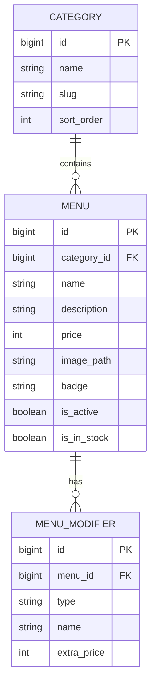

# RFC-002: Dashboard Admin Filament – Manajemen Menu, Kategori, Varian & Stok

**Features**: F31
**Depends on**: RFC-001
**Rules**: ARCH-3, ARCH-5, ARCH-6, SEC-4, CODE-1, CODE-4
**Complexity**: Medium

---

## 1. Summary
RFC ini mengimplementasikan panel administrasi berbasis **Filament Admin v3** (`/admin`) untuk mengelola katalog menu, kategori produk, pengaturan varian modifiers (suhu, kemanisan, jenis susu, topping ekstra), harga, unggah gambar polaroid, serta toggle status ketersediaan stok (*In Stock / Out of Stock*).

---

## 2. Technical Approach & Architecture

### A. Data Models & Schema


### B. File Structure
```
app/
├── Filament/
│   └── Resources/
│       ├── CategoryResource.php
│       ├── CategoryResource/Pages/
│       ├── MenuResource.php
│       └── MenuResource/Pages/
├── Models/
│   ├── Category.php
│   ├── Menu.php
│   └── MenuModifier.php
database/
├── migrations/
│   ├── 2026_10_23_000002_create_categories_table.php
│   ├── 2026_10_23_000003_create_menus_table.php
│   └── 2026_10_23_000004_create_menu_modifiers_table.php
└── seeders/
    ├── CategorySeeder.php
    └── MenuSeeder.php
```

---

## 3. Implementation Details
- Instalasi Filament Admin v3 via Composer (`filament/filament`).
- `CategoryResource`: Form nama, slug otomatis, dan urutan tampilan kategori (*Kopi Susu, Manual Brew, Makanan Berat, Camilan, Non-Kopi*).
- `MenuResource`: Form nama menu, relasi kategori, deskripsi, harga dalam Rupiah, upload gambar, badge stempel promo (*Favorit, Spesial*), dan repeater untuk varian susu/topping berbayar.
- `CategorySeeder` & `MenuSeeder`: Mengisi database awal dengan katalog menu dan gambar dari prototipe [`desain-web`](file:///d:/Projects/stud-web/desain-web).

---

## 4. Acceptance Criteria

- [ ] Panel Filament dapat diakses melalui rute `/admin` dengan autentikasi aman.
- [ ] Admin dapat melakukan CRUD kategori menu (tambah, edit, hapus, urutkan).
- [ ] Admin dapat melakukan CRUD item menu lengkap dengan gambar polaroid, harga, dan badge promo.
- [ ] Toggle status stok (*In Stock / Out of Stock*) berfungsi dan langsung tersimpan ke database.
- [ ] Seeder awal memuat kategori dan menu lengkap sesuai mock data kafe.
- [ ] Validasi form Filament menolak harga minus atau nama kosong.
