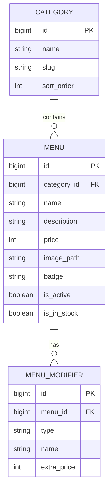

# RFC-002: Dashboard Admin Filament – Manajemen Menu, Kategori, Varian & Stok

**Features**: F31
**Depends on**: RFC-001
**Rules**: ARCH-3, ARCH-5, ARCH-6, SEC-4, CODE-1, CODE-4
**Complexity**: Medium

---

## 1. Summary
RFC ini mengimplementasikan panel administrasi berbasis **Filament Admin v3** (`/admin`) untuk mengelola katalog menu, kategori produk, pengaturan varian modifiers (suhu, kemanisan, jenis susu, topping ekstra), harga, unggah gambar polaroid, serta toggle status ketersediaan stok (*In Stock / Out of Stock*).

---

## 2. Technical Approach & Architecture

### A. Data Models & Schema


### B. File Structure
```
app/
├── Filament/
│   └── Resources/
│       ├── CategoryResource.php
│       ├── CategoryResource/Pages/
│       ├── MenuResource.php
│       └── MenuResource/Pages/
├── Models/
│   ├── Category.php
│   ├── Menu.php
│   └── MenuModifier.php
database/
├── migrations/
│   ├── 2026_10_23_000002_create_categories_table.php
│   ├── 2026_10_23_000003_create_menus_table.php
│   └── 2026_10_23_000004_create_menu_modifiers_table.php
└── seeders/
    ├── CategorySeeder.php
    └── MenuSeeder.php
```

---

## 3. Implementation Details
- Instalasi Filament Admin v3 via Composer (`filament/filament`).
- `CategoryResource`: Form nama, slug otomatis, dan urutan tampilan kategori (*Kopi Susu, Manual Brew, Makanan Berat, Camilan, Non-Kopi*).
- `MenuResource`: Form nama menu, relasi kategori, deskripsi, harga dalam Rupiah, upload gambar, badge stempel promo (*Favorit, Spesial*), dan repeater untuk varian susu/topping berbayar.
- `CategorySeeder` & `MenuSeeder`: Mengisi database awal dengan katalog menu dan gambar dari prototipe [`desain-web`](file:///d:/Projects/stud-web/desain-web).

---

## 4. Acceptance Criteria

- [x] Panel Filament dapat diakses melalui rute `/admin` dengan autentikasi aman.
- [x] Admin dapat melakukan CRUD kategori menu (tambah, edit, hapus, urutkan).
- [x] Admin dapat melakukan CRUD item menu lengkap dengan gambar polaroid, harga, dan badge promo.
- [x] Toggle status stok (*In Stock / Out of Stock*) berfungsi dan langsung tersimpan ke database.
- [x] Seeder awal memuat kategori dan menu lengkap sesuai mock data kafe.
- [x] Validasi form Filament menolak harga minus atau nama kosong.

---

## 5. Implementation Notes

Implementasi ulang diselesaikan pada 2026-10-25 secara bersih di branch `feature/rfc-002-dashboard-admin`:

1. **Struktur Panel & Routing:** Panel dikonfigurasi via `AdminPanelProvider` dengan id `admin`, path `admin`, warna tema `Amber`, tanpa widget scaffold info. Rute `/admin` terlindungi middleware `Authenticate`.
2. **Kategori Menu:** `CategoryResource` mengelola CRUD nama, slug otomatis (`Str::slug`), `sort_order`, toggle status aktif, dan aksi hapus.
3. **Item Menu & Modifiers:** `MenuResource` mengelola form menu lengkap dengan relasi kategori, deskripsi, harga Rupiah, upload gambar disk `public/menu-images/`, badge promo (`BadgeEnum`), dan kustomisasi repeater modifier. Table menu menangani tipe badge secara aman (`BadgeEnum|string|null`) untuk mencegah `TypeError` pada Filament v3.
4. **Pengujian Komprehensif:** Menambahkan cakupan pengujian lengkap untuk seluruh kriteria termasuk upload berkas gambar polaroid, aksi hapus menu & kategori, toggle ketersediaan stok, render daftar menu ber-badge, serta hidrasi & penyimpanan form badge.

### Bukti Verifikasi (2026-10-25)
- `php artisan test` ➔ **22 passed (104 assertions)**
  - `CategoryCrudTest`: 6 tests passed (auth wall, create, validasi nama, sort order, list render & delete, seeder).
  - `MenuCrudTest`: 8 tests passed (create with modifiers, validasi harga minus, validasi nama, badge list render, badge edit hydration & save, upload gambar polaroid, delete menu, seeder).
  - `MenuStockToggleTest`: 2 tests passed (toggle persists to DB, restored to DB).
  - `BadgeEnumTest`: 2 tests passed (labels, stable DB values).
  - `RootPageTest` & `WelcomePageTest`: 4 tests passed.
- `vendor/bin/pint --test` ➔ **passed** (100% PSR-12 bersih).
- `npm run build` ➔ **built in 622ms** (Vite 8.3.5, 626 modules).
- `php artisan migrate:fresh --seed --force` ➔ **bersih** (5 kategori, 6 menu, 11 modifier, 1 admin ter-seed).
- `php artisan route:list --path=admin` ➔ **9 routes terdaftar**.

