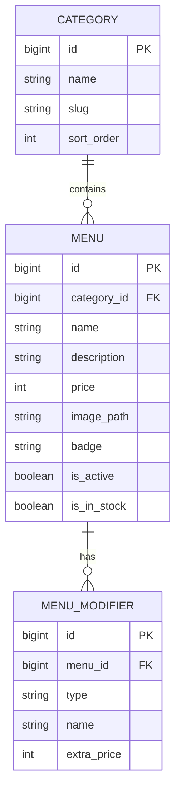

# RFC-002: Dashboard Admin Filament – Manajemen Menu, Kategori, Varian & Stok

**Features**: F31
**Depends on**: RFC-001
**Rules**: ARCH-3, ARCH-5, ARCH-6, SEC-4, CODE-1, CODE-4
**Complexity**: Medium

---

## 1. Summary
RFC ini mengimplementasikan panel administrasi berbasis **Filament Admin v3** (`/admin`) untuk mengelola katalog menu, kategori produk, pengaturan varian modifiers (suhu, kemanisan, jenis susu, topping ekstra), harga, unggah gambar polaroid, serta toggle status ketersediaan stok (*In Stock / Out of Stock*).

---

## 2. Technical Approach & Architecture

### A. Data Models & Schema


### B. File Structure
```
app/
├── Filament/
│   └── Resources/
│       ├── CategoryResource.php
│       ├── CategoryResource/Pages/
│       ├── MenuResource.php
│       └── MenuResource/Pages/
├── Models/
│   ├── Category.php
│   ├── Menu.php
│   └── MenuModifier.php
database/
├── migrations/
│   ├── 2026_10_23_000002_create_categories_table.php
│   ├── 2026_10_23_000003_create_menus_table.php
│   └── 2026_10_23_000004_create_menu_modifiers_table.php
└── seeders/
    ├── CategorySeeder.php
    └── MenuSeeder.php
```

---

## 3. Implementation Details
- Instalasi Filament Admin v3 via Composer (`filament/filament`).
- `CategoryResource`: Form nama, slug otomatis, dan urutan tampilan kategori (*Kopi Susu, Manual Brew, Makanan Berat, Camilan, Non-Kopi*).
- `MenuResource`: Form nama menu, relasi kategori, deskripsi, harga dalam Rupiah, upload gambar, badge stempel promo (*Favorit, Spesial*), dan repeater untuk varian susu/topping berbayar.
- `CategorySeeder` & `MenuSeeder`: Mengisi database awal dengan katalog menu dan gambar dari prototipe [`desain-web`](file:///d:/Projects/stud-web/desain-web).

---

## 4. Acceptance Criteria

- [x] Panel Filament dapat diakses melalui rute `/admin` dengan autentikasi aman.
- [x] Admin dapat melakukan CRUD kategori menu (tambah, edit, hapus, urutkan).
- [x] Admin dapat melakukan CRUD item menu lengkap dengan gambar polaroid, harga, dan badge promo.
- [x] Toggle status stok (*In Stock / Out of Stock*) berfungsi dan langsung tersimpan ke database.
- [x] Seeder awal memuat kategori dan menu lengkap sesuai mock data kafe.
- [x] Validasi form Filament menolak harga minus atau nama kosong.

## 5. Implementation Notes

Implementasi diselesaikan pada 2026-10-24. Deviasi & keputusan tercatat di bawah untuk reviewer:

1. **Path panel: `adminPanel` → `admin`.** Hasil `php artisan make:panel` bawaan memakai path `adminPanel`; disesuaikan menjadi `admin` agar memenuhi AC. ID panel juga diselaraskan menjadi `admin`.
2. **`BadgeEnum` diselaraskan ke RFC.** Enum hasil sesi sebelumnya berisi `NEW/POPULAR/LIMITED`; diganti menjadi `FAVORIT`/`SPESIAL` sesuai spesifikasi "badge stempel promo (*Favorit, Spesial*)" dan diberi method `label()`.
3. **Fitur Filament v4 tidak tersedia di v3.** `Filament\Forms\Components\SlugInput` dan `Section::helperText()` adalah API Filament v4. Pada v3 yang terpasang, slug diwujudkan sebagai `TextInput` + validasi regex `^[a-z0-9]+(?:-[a-z0-9]+)*$` (auto-generate `Str::slug` saat operasi create), dan section memakai `->description()`.
4. **Gambar polaroid belum berisi pada data seeder.** Mock prototipe (`desain-web`) memakai doodle SVG inline tanpa berkas gambar per menu, sehingga `image_path` menu hasil seeder dibiarkan `null`. Jalur unggah (`FileUpload` ke disk `public/menu-images/`, maks 2 MB, `storage:link` sudah dibuat) sudah berfungsi penuh; katalog publik RFC-004 akan menampilkan placeholder hingga admin mengunggah gambar.
5. **Perbaikan bug warisan `AdminUserSeeder`.** Import facade `Illuminate\Support\Facades\Env` salah (kelasnya `Illuminate\Support\Env`), membuat seluruh seeding gagal; diperbaiki. `DatabaseSeeder` juga tidak lagi membuat user contoh scaffold dan kini memanggil `AdminUserSeeder`, `CategorySeeder`, dan `MenuSeeder`.
6. **Komentar migrasi diluruskan.** Komentar `// stored in cents` pada kolom `price`/`extra_price` bertentangan dengan `formatRupiah` dan data mock (22000 = Rp 22.000); diperbaiki menjadi Rupiah. Nilai kolom tidak berubah.
7. **Varian berbayar saja di level data.** Seeder mengisi modifier susu & topping berbayar (sesuai mock kustomisasi). Opsi gratis (suhu, kemanisan) sengaja tidak dijadikan baris modifier karena akan ditangani sebagai state UI di drawer kustomisasi RFC-004; kolom `type` tetap mengizinkan `suhu`/`kemanisan` bila diperlukan nanti.
8. **Otorisasi berbasis autentikasi saja.** Sesuai SEC-4, akses `/admin` dilindungi login Filament + bcrypt. Belum ada pembagian role admin vs kasir (akan relevan di RFC-007); setiap user yang terautentikasi dapat mengelola katalog.

### Bukti Verifikasi (2026-10-24)
- `php artisan migrate:fresh --seed --force` → bersih, 5 kategori + 6 menu + 11 modifier ter-seed.
- `php artisan test` → **15 test passed (68 assertions)**, mencakup `CategoryCrudTest` (TC-002-1), `MenuCrudTest` (TC-002-2 + validasi), `MenuStockToggleTest` (TC-002-3), serta proteksi `/admin` untuk guest.
- `vendor/bin/pint app database tests config` → bersih (PSR-12, RULES CODE-1).
- `npm run build` → sukses (Vite 8.3.5, 626 modul).
- `php artisan route:list` → rute `admin`, `admin/login`, `admin/categories*`, `admin/menus*` terdaftar.
