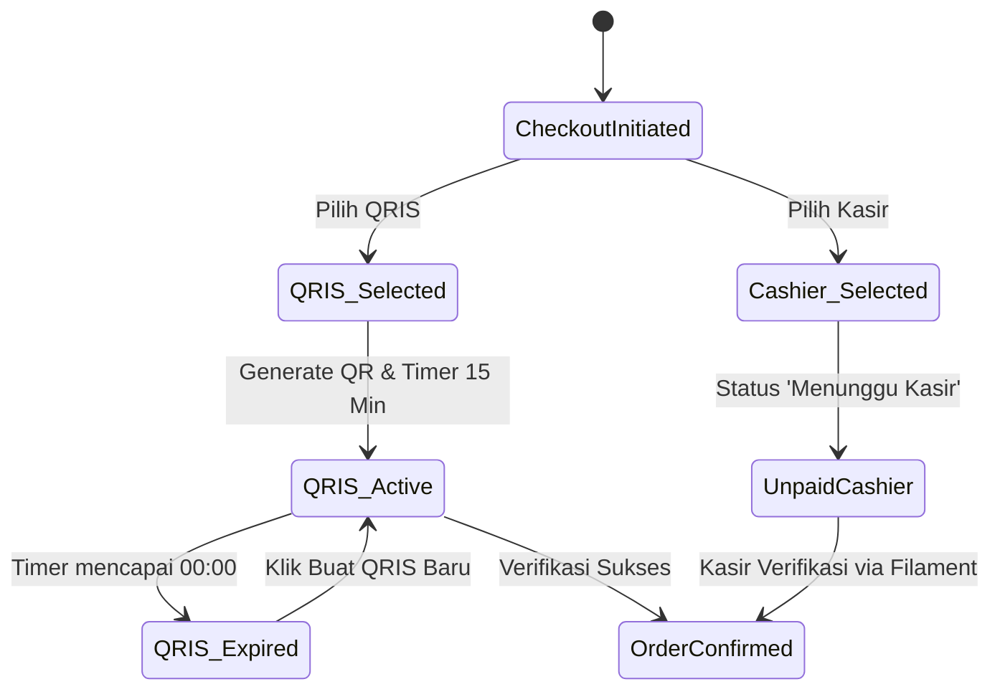

# RFC-006: Alur Pembayaran (QRIS Dinamis 15 Menit & Bayar di Kasir)

**Features**: F16, F17, F18, F19
**Depends on**: RFC-005
**Rules**: UI-1, UI-4, DATA-4, SEC-1, CODE-1, CODE-2
**Complexity**: Medium

---

## 1. Summary
RFC ini mengimplementasikan alur pemilihan metode pembayaran dan proses checkout ke backend Laravel:
1. Radio selector 3 metode: **QRIS Instan**, **E-Wallet Langsung**, dan **Bayar di Kasir**.
2. Pembuatan record transaksi pesanan baru di database melalui `OrderController@store`.
3. Modal pembayaran QRIS dinamis lengkap dengan logo kafe, timer hitung mundur 15 menit, dan tombol unduh/simpan QR.
4. Penanganan kedaluwarsa QRIS ketika timer mencapai 00:00 dengan tombol buat QRIS baru.
5. Alur pesanan khusus "Bayar di Kasir" dengan status awal `unpaid_cashier` (*Menunggu Pembayaran di Kasir*).

---

## 2. Technical Approach & Architecture

### A. State Machine Transaksi Pembayaran


### B. File Structure
```
app/
├── Http/
│   └── Controllers/
│       └── OrderController.php
resources/
├── js/
│   ├── Components/
│   │   ├── PaymentMethodSelector.jsx
│   │   └── QRISModal.jsx
│   └── Pages/
│       └── Checkout.jsx
```

---

## 3. Implementation Details

- Mengadaptasi layout visual dari [`05_pembayaran_qris/code.html`](file:///d:/Projects/stud-web/desain-web/05_pembayaran_qris/code.html).
- **Generator QRIS Dinamis (`QRISModal.jsx`)**:
  - Menggunakan library `qrcode` (v1.5.4) untuk me-render canvas QR code.
  - Timer 15 menit berjalan mundur per detik (`15:00` -> `00:00`).
  - Saat waktu habis, overlay stempel "QR Kedaluwarsa" menutupi kode dan mengaktifkan tombol "Buat QRIS Baru".
  - Tombol unduh QR menyimpan berkas gambar ke perangkat.
- **Payload Pembuatan Order (`OrderController@store`)**:
  - Menerima: nomor meja (atau data takeaway: nama, no WA, jam ambil), array item, catatan, metode bayar, kupon promo.
  - Memvalidasi total nominal di backend untuk mencegah manipulasi harga dari sisi klien.
  - Menghasilkan kode pesanan unik (contoh: `#ORD-2601` untuk Dine-in atau `#TK-108` untuk Takeaway).

---

## 4. Acceptance Criteria

- [x] Pengguna dapat memilih antara QRIS, E-Wallet, atau Bayar di Kasir dengan indikator visual radio aktif.
- [x] Memilih QRIS menampilkan barcode QR dinamis berlogo kafe dengan timer 15 menit.
- [x] Hitung mundur timer berjalan akurat detik demi detik.
- [x] Ketika timer mencapai 00:00, QR dinonaktifkan dan tombol "Buat QRIS Baru" dapat diakses.
- [x] Tombol unduh QR berhasil mengekspor berkas gambar QR.
- [x] Memilih Bayar di Kasir membuat pesanan dengan status `unpaid_cashier` dan pesan petunjuk kasir.
- [x] Backend memvalidasi integritas harga item dan perhitungan pajak secara aman.

---

## 5. Implementation Notes

- **Migrasi Database & Relasi Eloquent:** Tabel `orders` dan `order_items` dibuat lengkap dengan relasi Eloquent (`Order` hasMany `OrderItem`), status state machine sesuai `DATA-4`, dan format kode unik (`#ORD-XXXX` untuk Dine-In dan `#TK-XXX` untuk Takeaway).
- **Proteksi Integritas Harga (`OrderController@store`):** Server menghitung ulang harga asli menu dan modifier dari database untuk mencegah manipulasi harga dari sisi klien (`SEC-1`). Diskon kupon `SKETCHKOPI` (10%) dan pajak PB1 (10%) diverifikasi secara aman dalam transaksi `DB::transaction`.
- **Generator QRIS Dinamis & Countdown:** Library `qrcode` (v1.5.4) diintegrasikan untuk menggambar kode QR pada canvas HTML, disertai timer hitung mundur 15 menit akurat per detik, stempel overlay kedaluwarsa, tombol "Buat QRIS Baru", dan fitur ekspor gambar QR ("Unduh QR Code").
- **Modal Instruksi Bayar di Kasir:** Pesanan dengan metode kasir disimpan dengan status awal `unpaid_cashier` dan menampilkan `CashierInstructionModal` yang memandu pelanggan mendatangi meja kasir dengan membawa kode pesanan unik mereka.
