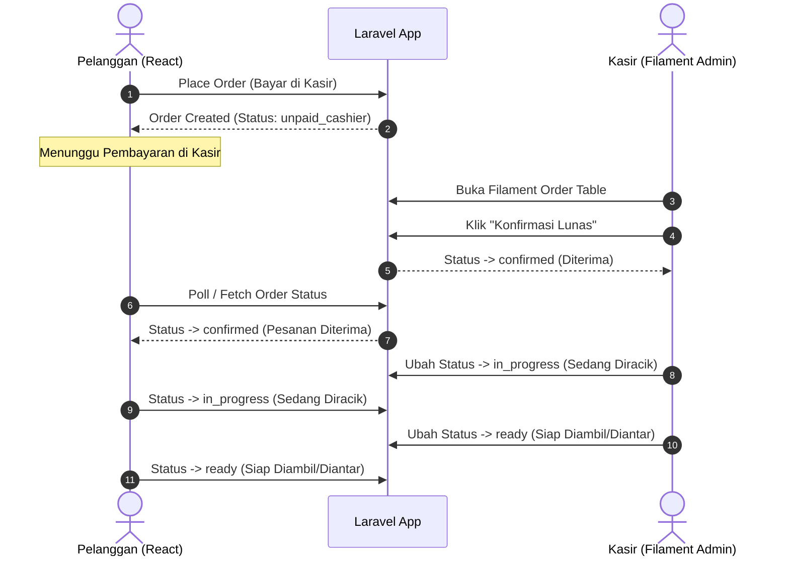

# RFC-007: Operasional Kasir Filament & Pelacakan Pesanan Real-Time Pelanggan

**Features**: F20, F21, F22, F32
**Depends on**: RFC-002, RFC-006
**Rules**: ARCH-3, DATA-4, UI-1, UI-4, SEC-3, SEC-4, CODE-1
**Complexity**: High

---

## 1. Summary
RFC ini menghubungkan operasional staf kasir di Filament Admin dengan pelacakan status pesanan real-time di layar smartphone pelanggan:
1. Pembuatan resource pesanan kasir di Filament Admin (`OrderResource`) untuk memfilter pesanan belum lunas, melakukan konfirmasi pembayaran, dan memajukan tahapan peracikan barista.
2. Halaman pelacak pesanan pelanggan di React (`/order/track/{id}`) yang menampilkan tahapan visual bertahap (*Diterima -> Sedang Diracik -> Siap Diambil*).
3. Tombol "Panggil Pelayan" dan tombol kontrol simulasi status pesanan untuk mode demo/testing.

---

## 2. Technical Approach & Architecture

### A. Lifecycle Synchronization


### B. File Structure
```
app/
├── Filament/
│   └── Resources/
│       ├── OrderResource.php
│       └── OrderResource/Pages/ListOrders.php
resources/
├── js/
│   ├── Components/
│   │   ├── OrderStatusStepper.jsx
│   │   ├── OrderSummaryBox.jsx
│   │   └── StatusSimulationControls.jsx
│   └── Pages/
│       └── Tracker.jsx
```

---

## 3. Implementation Details

- Mengadaptasi layout visual dari [`06_pelacak_pesanan_real_time/code.html`](file:///d:/Projects/stud-web/desain-web/06_pelacak_pesanan_real_time/code.html).
- **Layar Pelacak React (`Tracker.jsx`)**:
  - Header kartu nomor meja / kode tiket takeaway.
  - Stepper visual tahapan pesanan:
    - Opsi Bayar di Kasir: *Menunggu Kasir* -> *Diterima* -> *Sedang Diracik* -> *Siap Diambil*.
    - Opsi Online: *Diterima* -> *Sedang Diracik* -> *Siap Diambil*.
  - Ikon tahapan aktif menyala dengan mikro-animasi denyut (pulse).
  - Rincian pesanan dan estimasi waktu tunggu (misal: "12 menit lagi").
- **Filament Admin `OrderResource`**:
  - Filter tab: *Semua, Menunggu Pembayaran, Sedang Diproses, Selesai*.
  - Tombol aksi baris: "Konfirmasi Lunas", "Mulai Diracik", "Tandai Siap".
- **Kontrol Simulasi (`StatusSimulationControls.jsx`)**:
  - Panel kontrol khusus yang hanya muncul pada mode demo untuk menguji perubahan status UI secara instan.

---

## 4. Acceptance Criteria

- [ ] Setelah checkout, pelanggan otomatis dialihkan ke halaman pelacak pesanan `/order/track/{id}`.
- [ ] Pesanan bayar di kasir menampilkan status awal "Menunggu Pembayaran di Kasir".
- [ ] Panel Filament Admin `/admin/orders` menampilkan seluruh pesanan masuk secara real-time.
- [ ] Kasir dapat menekan tombol "Konfirmasi Lunas", dan status pesanan berubah menjadi `confirmed`.
- [ ] Pelacak pesanan pelanggan mencerminkan perubahan status ke "Pesanan Diterima" dan "Sedang Diracik".
- [ ] Stepper visual menampilkan ikon aktif dengan animasi denyut.
- [ ] Tombol simulasi demo memajukan status pesanan secara instan saat diklik.
- [ ] Pelanggan hanya dapat melihat status pesanan miliknya sendiri.
