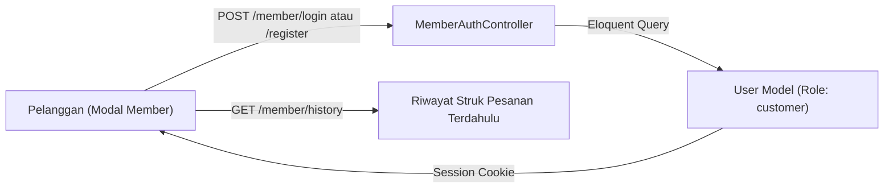

# RFC-008: Autentikasi Akun Member, Polish UI & Pengujian E2E

**Features**: F24
**Depends on**: RFC-007
**Rules**: ARCH-3, SEC-1, SEC-3, CODE-1, TEST-1, TEST-2, TEST-3
**Complexity**: Medium

---

## 1. Summary
RFC ini menyelesaikan modul akhir aplikasi:
1. Modal registrasi, login, dan riwayat pesanan bagi pelanggan berstatus **Member**.
2. Efek visual perayaan konfeti menggunakan library `canvas-confetti` (v1.9.4) saat pesanan berhasil terbuat.
3. Polish tampilan taktil sketchbook kafe dan audit konsistensi visual di seluruh viewport (mobile portrait 360px - 430px hingga tablet kiosk).
4. Pengujian end-to-end (E2E) mekanis untuk memastikan seluruh acceptance criteria dari RFC-001 hingga RFC-007 lulus tanpa celah.

---

## 2. Technical Approach & Architecture

### A. Member Authentication Data Flow


### B. File Structure
```
app/
├── Http/
│   └── Controllers/
│       └── MemberAuthController.php
resources/
├── js/
│   ├── Components/
│   │   ├── MemberAuthModal.jsx
│   │   └── OrderHistoryModal.jsx
│   └── Utils/
│       └── triggerConfetti.js
```

---

## 3. Implementation Details

- **Modal Member (`MemberAuthModal.jsx`)**:
  - Tab Masuk & Daftar.
  - Input: Nama, Nomor WhatsApp, dan PIN 6 angka.
  - Sesi tersimpan aman dalam Laravel session.
- **Riwayat Pesanan (`OrderHistoryModal.jsx`)**:
  - Menampilkan daftar struk transaksi terdahulu pelanggan yang berstatus selesai.
- **Konfeti Perayaan (`triggerConfetti.js`)**:
  - Menggunakan `canvas-confetti` saat pesanan berhasil dibuat dengan warna palet sketchbook (`#FFC93C`, `#FF7A59`, `#7ED6A5`, `#6EC6FF`).
- **Verifikasi Matematis & Toleransi E2E**:
  - Memverifikasi tidak ada kebocoran layout horizontal pada resolusi 360px, 375px, 390px, dan 414px.

---

## 4. Acceptance Criteria

- [ ] Pelanggan dapat mendaftarkan akun member dengan Nama, WhatsApp, dan PIN.
- [ ] Member yang login dapat membuka riwayat struk pesanan terdahulunya.
- [ ] Animasi konfeti warna-warni menyala saat pesanan berhasil terkonfirmasi.
- [ ] Seluruh tombol dan kartu mematuhi aturan warna tinta espresso `#4A2C17` dan latar kertas `#FFF9EF`.
- [ ] Tidak terjadi horizontal overflow pada layar mobile (360px - 430px).
- [ ] Seluruh skenario alur pesanan dari scan QR / takeaway hingga status selesai teruji lulus secara end-to-end.
