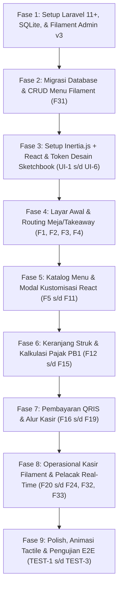

# Project Rules & Technical Standards (RULES.md)
## Kopi Corat-Coret – Self-Order Web App ("Sketchbook Kafe")

- **Version:** 2.0.0 (Updated via CR-001: Laravel + Inertia React + Filament)
- **Status:** Active / Implementation Standard
- **Source Documents:** [`PRD.md`](file:///d:/Projects/stud-web/PRD.md) (v3.0.0), [`FEATURES.md`](file:///d:/Projects/stud-web/FEATURES.md), [`changes/CHANGE-REQUEST-001.md`](file:///d:/Projects/stud-web/changes/CHANGE-REQUEST-001.md)
- **Design System Reference:** [`desain-web/sketchbook_kafe/DESIGN.md`](file:///d:/Projects/stud-web/desain-web/sketchbook_kafe/DESIGN.md)

---

## 1. Project Overview & Architecture Vision
Kopi Corat-Coret adalah aplikasi web pemesanan mandiri (*self-ordering*) berbasis mobile-first yang mengusung estetika visual unik **Tactile / Skeuomorphic Sketchbook** (kertas bertekstur hangat, garis tinta espresso, doodle washi-tape, dan bayangan solid marker). Sistem dibangun dengan arsitektur monolit modern terintegrasi:
- **Backend:** **Laravel (PHP 8.2+)** dengan database relasional (SQLite / MySQL) melalui Eloquent ORM.
- **Frontend Pelanggan:** **Inertia.js + React** yang mengadopsi 100% sistem desain tactile [DESIGN.md](file:///d:/Projects/stud-web/desain-web/sketchbook_kafe/DESIGN.md).
- **Back-Office & Kasir:** **Filament Admin** untuk manajemen menu, kategori, stok, dan verifikasi antrean pesanan kasir.

---

## 2. Product Type & Audit Scope

- **Product Type:** `web app` (Fullstack Web Application: Laravel + Inertia React + Filament)

### Applicable Checks Probed:
- **Auth and Sessions:** Sesi ganda tanpa login (*Guest Checkout*) dan akun member via Laravel Session/Auth, serta otentikasi aman admin via Filament.
- **Authorization per Resource:** Proteksi sesi; pelanggan hanya dapat melihat status pesanan miliknya; staf kasir/admin mengelola pesanan via panel Filament terproteksi.
- **Data Model & Migrations:** Struktur database relasional terstruktur via migrasi Laravel (tabel `menus`, `categories`, `orders`, `order_items`, `coupons`, `users`).
- **Accessibility:** Kontras warna minimum WCAG AA antara tinta espresso `#4A2C17` dan latar kertas `#FFF9EF`, touch target minimal 44x44px.
- **Responsive Layout:** Optimalisasi tampilan vertikal (*mobile portrait* 360px - 430px) pada sisi pelanggan, dan responsif desktop/tablet pada panel Filament Admin.
- **Browser Support:** Kompatibel dengan Mobile Safari iOS, Chrome Android, Samsung Internet, dan in-app webview (Instagram, QR scanner).
- **Page-Load Budget:** Waktu muat awal di bawah 2 detik dengan Vite bundling teroptimasi.
- **SEO for Public Pages:** Struktur meta tag OpenGraph dasar untuk pratinjau tautan media sosial.

### Skipped Checks (with Justification):
- `binary size`: Diabaikan karena aplikasi dijalankan langsung via browser web tanpa paket instalasi biner native (APK/IPA).
- `offline sync`: Diabaikan karena alur verifikasi menu, sinkronisasi transaksi, dan notifikasi kasir secara esensial membutuhkan koneksi internet aktif ke kafe.

---

## 3. Technology Stack & Registry-Verified Dependencies

Seluruh dependensi pihak ketiga di bawah ini telah diverifikasi langsung terhadap registri resmi `npm` dan ekosistem `packagist`:

| Kategori / Paket | Versi Terverifikasi | Registri / Sumber | Tujuan Penggunaan |
|---|:---:|:---:|---|
| **PHP Runtime** | `>= 8.2.0` | PHP Official | Runtime eksekusi backend Laravel |
| **Laravel Framework** | `^11.0` (atau `^12.0`) | Packagist (`composer`) | Framework web backend, Eloquent ORM, migrasi skema |
| **Filament Admin** | `^3.2` | Packagist (`filament/filament`) | Panel administrasi katalog menu, stok, dan operasional kasir |
| **@inertiajs/react** | `3.9.1` | npm (`npm view @inertiajs/react version`) | Adapter Inertia.js untuk rendering komponen React |
| **React** | `19.3.1` | npm (`npm view react version`) | Library UI reaktif sisi pelanggan |
| **Vite** | `8.3.5` | npm (`npm view vite version`) | Build tool & asset bundler modern berkecepatan tinggi |
| **Database** | SQLite (dev) / MySQL | Standard RDBMS | Penyimpanan relasional persisten |
| **Google Fonts** | Hosted API | Google Fonts | Font `Epilogue` (Display/Headlines) & `Nunito Sans` (Body & Angka) |
| **Material Symbols Outlined** | Hosted CDN | Google Fonts API | Ikonografi doodle ramah sentuh |
| **qrcode** | `1.5.4` | npm (`npm view qrcode version`) | Generator kode QR dinamis untuk pembayaran QRIS instan |
| **canvas-confetti** | `1.9.4` | npm (`npm view canvas-confetti version`) | Animasi perayaan visual saat pesanan berhasil terkonfirmasi |

---

## 4. Technical Rules & Standards

### Architecture & Modularity (ARCH)
- **ARCH-1**: [REMOVED - Digantikan oleh ARCH-5 untuk arsitektur Laravel + Inertia + React]
- **ARCH-2**: [REMOVED - Digantikan oleh ARCH-6 untuk arsitektur database relasional Laravel & Filament]
- **ARCH-3**: Struktur direktori proyek harus tertata rapi mengikuti konvensi Laravel + Inertia:
  - `app/Filament/Resources/`: Resource panel admin Filament (MenuResource, CategoryResource, OrderResource).
  - `app/Http/Controllers/`: Controller Inertia untuk routing halaman pelanggan (`MenuController.php`, `OrderController.php`).
  - `app/Models/`: Model Eloquent (`Menu.php`, `Category.php`, `Order.php`, `OrderItem.php`).
  - `resources/js/Components/`: Komponen React modular (Navbar, Banner, CustomizerDrawer, CartDocket, PaymentModal, OrderTracker).
  - `resources/js/Pages/`: Halaman utama Inertia (`Welcome.jsx`, `Catalog.jsx`, `Checkout.jsx`, `Tracker.jsx`).
  - `resources/css/`: Token desain, variabel CSS, dan gaya tema sketchbook (`tokens.css`, `tactile.css`, `app.css`).
  - `database/migrations/`: Migrasi skema database terstruktur.
- **ARCH-4**: Pemisahan mode pemesanan: Logika inisialisasi pada root router harus memeriksa query parameter `table`. Keberadaan parameter `table` mengunci mode ke *Dine-In*, ketiadaan parameter mengunci mode ke *Takeaway*.
- **ARCH-5**: Aplikasi dibangun menggunakan arsitektur monolit modern **Laravel 11+** di backend, **Inertia.js + React** di frontend pelanggan, dan **Filament PHP 3+** untuk panel administrasi kasir/manajemen.
- **ARCH-6**: Penyimpanan data utama menggunakan database relasional (SQLite/MySQL) melalui Eloquent ORM dengan migrasi skema terstruktur.
- **ARCH-7**: Struktur direktori dan penamaan berkas frontend React wajib konsisten menggunakan ekstensi `.jsx` untuk komponen dan `.js` untuk fungsi utilitas.

### Komunikasi API & Protokol Inertia (API)
- **API-1**: Komunikasi antara frontend pelanggan React dan backend Laravel menggunakan protokol Inertia.js untuk perpindahan halaman dan passing state props tanpa overhead REST API manual terpisah.

### Design System & Visual Aesthetics (UI) — Citing NFR-1, NFR-2, NFR-5
- **UI-1**: Seluruh antarmuka pelanggan React wajib mengacu 100% pada spesifikasi sistem desain [DESIGN.md](file:///d:/Projects/stud-web/desain-web/sketchbook_kafe/DESIGN.md) (NFR-1).
- **UI-2**: Batasan palet warna: Latar utama kertas sketsa `#FFF9EF`, tinta espresso `#4A2C17`, kuning ceria `#FFC93C`, krem kontainer `#FFF1D6`, dan aksen jingga promo `#FF7A59`. Dilarang keras menggunakan warna hitam digital murni (`#000000`).
- **UI-3**: Ketetapan tipografi: Seluruh judul (*headings*) menggunakan **Epilogue** (bobot 700/800); teks isi, deskripsi menu, dan harga menggunakan **Nunito Sans** (bobot 600/700/800).
- **UI-4**: Elevasi & Kedalaman Taktil: Menolak efek blur/ambient glow digital. Semua kartu, chip, dan tombol wajib menggunakan bayangan solid hard shadow `3px 3px 0px #4A2C17` atau `4px 4px 0px #4A2C17`. Saat ditekan (*active/press*), elemen berpindah `translate(2px, 2px)` dan bayangan menciut menjadi `1px 1px 0px #4A2C17` untuk menghasilkan sentuhan taktil instan (NFR-2).
- **UI-5**: Dekorasi sketchbook wajib menyertakan elemen fisik: pita washi tape berotasi ±2.5° semi-transparan, garis pemisah bergelombang (*squiggly doodle*), dan batas bawah nota kasir bergerigi (*zigzag receipt cut*).
- **UI-6**: Fleksibilitas tampilan: Tampilan antarmuka pelanggan harus optimal pada resolusi mobile portrait (320px - 430px) dan terpusat rapi dalam kontainer maksimal 480px saat dibuka pada layar lebar atau tablet kiosk (NFR-5).

### Data Handling & Persistence (DATA) — Citing NFR-3, NFR-6
- **DATA-1**: Persistensi database utama: Data katalog, pesanan, dan transaksi disimpan persisten di database Laravel, sedangkan `localStorage` di sisi klien hanya digunakan untuk caching sesi keranjang cepat saat memilih menu (NFR-3, NFR-6).
- **DATA-2**: Keandalan penyimpanan: Operasi mutasi database wajib menggunakan database transaction (`DB::transaction`) untuk memastikan integritas pembuatan order dan item rincian pesanan.
- **DATA-3**: Identitas item keranjang: ID unik item keranjang di sisi React harus dibentuk secara deterministik dari gabungan `menuId` dan hash varian/add-on yang dipilih, sehingga item dengan kustomisasi identik diakumulasikan kuantitasnya, sedangkan kustomisasi berbeda menjadi baris terpisah.
- **DATA-4**: Siklus status pesanan (*State Machine*):
  - Alur Bayar di Kasir: `unpaid_cashier` -> (Verifikasi Kasir via Filament) -> `confirmed` -> `in_progress` -> `ready` -> `completed`.
  - Alur QRIS / E-Wallet: `confirmed` -> `in_progress` -> `ready` -> `completed`.

### Security & Form Validation (SEC) — Citing NFR-4
- **SEC-1**: Pencegahan XSS & Sanitasi: Seluruh input teks pengguna (nama pelanggan takeaway, nomor WhatsApp, catatan khusus untuk barista) wajib divalidasi via Laravel Form Request dan di-escape sebelum dirender ke DOM.
- **SEC-2**: Validasi form ramah corat-coret: Validasi input form Takeaway harus menerapkan aturan ketat: Nama minimal 3 karakter, nomor WhatsApp valid format Indonesia (`/^08[0-9]{8,11}$/`), dan estimasi jam ambil minimal 10 menit ke depan (NFR-4).
- **SEC-3**: Isolasi pesanan aktif: Pelanggan hanya diperkenankan melihat struk dan status pesanan yang terkait dengan ID sesi/pesanan miliknya via middleware atau session token.
- **SEC-4**: Keamanan panel kasir: Akses ke Filament Admin (`/admin`) wajib dilindungi autentikasi bawaan Laravel/Filament dengan hashing password bcrypt.

### Code Quality & Standards (CODE)
- **CODE-1**: Standar kode PHP mengikuti PSR-12 dan konvensi Laravel; kode React menggunakan modern hooks (useState, useEffect, useMemo) dan komponen fungsional bersih.
- **CODE-2**: Format mata uang terpusat: Semua nilai nominal Rupiah wajib diformat menggunakan fungsi utilitas terpusat `formatRupiah(amount)` menghasilkan format standar (contoh: `Rp 28.000`).
- **CODE-3**: Larangan kode sampah: Dilarang menyisakan `console.log` debug yang tidak perlu, kode komentar mati, atau blok fungsi yang belum rampung (`// TODO` tanpa implementasi).
- **CODE-4**: Ketepatan penamaan: Variabel dan fungsi menggunakan format `camelCase`, komponen React menggunakan `PascalCase`, dan model Eloquent menggunakan `SingularPascalCase`.

### Testing & Verification (TEST)
- **TEST-1**: Seluruh fitur prioritas Must-Have (`F1`, `F2`, `F5`, `F8`, `F12`, `F14`, `F16`, `F17`, `F20`, `F21`, `F25`, `F26`, `F31`, `F32`, `F33`) wajib dapat diuji fungsionalitasnya secara mekanis atau melalui interaksi peramban end-to-end.
- **TEST-2**: Uji ketahanan migrasi database: Seluruh migrasi Laravel wajib dapat dieksekusi bersih (`php artisan migrate:fresh`) tanpa kegagalan foreign key.
- **TEST-3**: Uji integritas matematis: Perhitungan subtotal, diskon kupon 10%, pajak restoran PB1 10%, dan total akhir pembayaran pada struk belanja wajib akurat hingga digit Rupiah terakhir tanpa kesalahan pembulatan desimal.

---

## 5. Implementation Sequence & Critical Path

Untuk memastikan proses pengembangan berjalan efisien dan terarah, implementasi kode wajib mengikuti urutan berfase:

---

## 6. AI Agent Configuration Wiring

Aturan teknis ini dihubungkan langsung ke seluruh agen AI yang bekerja di repositori ini:
- **Antigravity / Gemini CLI / Codex**: Terhubung via [`AGENTS.md`](file:///d:/Projects/stud-web/AGENTS.md).
- **Claude Code**: Terhubung via [`CLAUDE.md`](file:///d:/Projects/stud-web/CLAUDE.md).
