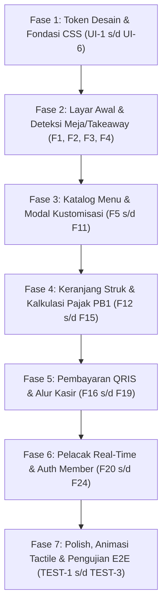

# Project Rules & Technical Standards (RULES.md)
## Kopi Corat-Coret – Self-Order Web App ("Sketchbook Kafe")

- **Version:** 1.0.0
- **Status:** Active / Implementation Standard
- **Source Documents:** [`PRD.md`](file:///d:/Projects/stud-web/PRD.md) (v2.0.0), [`FEATURES.md`](file:///d:/Projects/stud-web/FEATURES.md), [`PRD-REVIEW.md`](file:///d:/Projects/stud-web/PRD-REVIEW.md)
- **Design System Reference:** [`desain-web/sketchbook_kafe/DESIGN.md`](file:///d:/Projects/stud-web/desain-web/sketchbook_kafe/DESIGN.md)

---

## 1. Project Overview & Architecture Vision
Kopi Corat-Coret adalah aplikasi web pemesanan mandiri (*self-ordering*) berbasis mobile-first yang mengusung estetika visual unik **Tactile / Skeuomorphic Sketchbook** (kertas bertekstur hangat, garis tinta espresso, doodle washi-tape, dan bayangan solid marker). Sistem beroperasi sepenuhnya secara mandiri pada sisi klien (*client-side*) menggunakan browser modern dan `localStorage` untuk manajemen keranjang, sesi meja/takeaway, katalog menu mock, serta pelacak status pesanan bertahap.

---

## 2. Product Type & Audit Scope

- **Product Type:** `web app` (Mobile-First Responsive Web Application)

### Applicable Checks Probed:
- **Auth and Sessions:** Sesi ganda tanpa login (*Guest Checkout*) dan akun member ringan berbasis penyimpanan lokal.
- **Authorization per Resource:** Proteksi sesi; pengguna hanya dapat mengakses dan memantau pesanan aktif milik sesinya sendiri.
- **Data Model & Migrations:** Struktur skema data terstruktur pada `localStorage` (`kopi_cart`, `kopi_orders`, `kopi_member_session`, `kopi_active_order_id`).
- **Accessibility:** Kontras warna minimum WCAG AA antara tinta espresso `#4A2C17` dan latar kertas `#FFF9EF`, touch target minimal 44x44px.
- **Responsive Layout:** Optimalisasi tampilan vertikal (*mobile portrait* 360px - 430px) dengan wadah terpusat pada tablet/desktop (*max-width: 480px*).
- **Browser Support:** Kompatibel dengan Mobile Safari iOS, Chrome Android, Samsung Internet, dan in-app webview (Instagram, QR scanner).
- **Page-Load Budget:** Waktu muat awal (*First Contentful Paint*) di bawah 1.5 detik pada koneksi standar.
- **SEO for Public Pages:** Struktur meta tag OpenGraph dasar untuk pratinjau tautan media sosial.

### Skipped Checks (with Justification):
- `binary size`: Diabaikan karena aplikasi dijalankan langsung via browser web tanpa paket instalasi biner native (APK/IPA).
- `offline sync`: Diabaikan karena alur verifikasi menu dan pemesanan secara esensial membutuhkan koneksi internet aktif ke kafe.

---

## 3. Technology Stack & Registry-Verified Dependencies

Seluruh dependensi pihak ketiga di bawah ini telah diverifikasi langsung terhadap registri resmi `npm`:

| Kategori / Paket | Versi Terverifikasi | Registri | Tujuan Penggunaan |
|---|:---:|:---:|---|
| **Vite** | `8.3.5` | npm (`npm view vite version`) | Build tool & local development server modern yang cepat |
| **Node.js Runtime** | `>= 20.0.0` | Node.js LTS | Lingkungan eksekusi build dan toolings |
| **HTML5 & CSS3** | Modern Standards | W3C Standard | Struktur semantik & Vanilla CSS tokens sesuai [DESIGN.md](file:///d:/Projects/stud-web/desain-web/sketchbook_kafe/DESIGN.md) |
| **JavaScript (ES Modules)** | `ES2022+` | TC39 Standard | Logika interaktif reaktif dan state management klien |
| **Google Fonts** | Hosted API | Google Fonts | Font `Epilogue` (Display/Headlines) & `Nunito Sans` (Body & Angka) |
| **Material Symbols Outlined** | Hosted CDN | Google Fonts API | Ikonografi doodle ramah sentuh |
| **qrcode** | `1.5.4` | npm (`npm view qrcode version`) | Generator kode QR dinamis untuk pembayaran QRIS instan |
| **canvas-confetti** | `1.9.4` | npm (`npm view canvas-confetti version`) | Animasi perayaan visual saat pesanan berhasil terkonfirmasi |

---

## 4. Technical Rules & Standards

### Architecture & Modularity (ARCH)
- **ARCH-1**: Aplikasi harus dibangun dengan arsitektur Single-Page Application (SPA) berbasis komponen modular tanpa dependensi server runtime eksternal untuk rilis MVP.
- **ARCH-2**: Struktur direktori proyek harus tertata rapi sebagai berikut:
  - `src/components/`: Komponen antarmuka modular (Navbar, Banner, Catalog, CustomizerDrawer, CartDocket, PaymentModal, OrderTracker, MemberAuth).
  - `src/data/`: Data mock statis awal (katalog menu, kategori, daftar promo, Wi-Fi credentials).
  - `src/services/`: Logika bisnis dan penyimpanan (`storageService.js`, `cartService.js`, `orderService.js`).
  - `src/styles/`: Token desain, variabel CSS, dan gaya tema sketchbook (`tokens.css`, `tactile.css`, `main.css`).
  - `src/utils/`: Fungsi pembantu murni (`formatRupiah.js`, `urlParams.js`, `timer.js`).
- **ARCH-3**: Alur data harus bersifat satu arah (*unidirectional data flow*): Interaksi UI memanggil modul Service -> Service memodifikasi `localStorage` dan memancarkan event perubahan -> Komponen me-render ulang UI yang terpengaruh.
- **ARCH-4**: Pemisahan mode pemesanan: Logika inisialisasi pada root router harus memeriksa query parameter `table`. Keberadaan parameter `table` mengunci mode ke *Dine-In*, ketiadaan parameter mengunci mode ke *Takeaway*.

### Design System & Visual Aesthetics (UI) — Citing NFR-1, NFR-2, NFR-5
- **UI-1**: Seluruh antarmuka wajib mengacu 100% pada spesifikasi sistem desain [DESIGN.md](file:///d:/Projects/stud-web/desain-web/sketchbook_kafe/DESIGN.md) (NFR-1).
- **UI-2**: Batasan palet warna: Latar utama kertas sketsa `#FFF9EF`, tinta espresso `#4A2C17`, kuning ceria `#FFC93C`, krem kontainer `#FFF1D6`, dan aksen jingga promo `#FF7A59`. Dilarang keras menggunakan warna hitam digital murni (`#000000`).
- **UI-3**: Ketetapan tipografi: Seluruh judul (*headings*) menggunakan **Epilogue** (bobot 700/800); teks isi, deskripsi menu, dan harga menggunakan **Nunito Sans** (bobot 600/700/800).
- **UI-4**: Elevasi & Kedalaman Taktil: Menolak efek blur/ambient glow digital. Semua kartu, chip, dan tombol wajib menggunakan bayangan solid hard shadow `3px 3px 0px #4A2C17` atau `4px 4px 0px #4A2C17`. Saat ditekan (*active/press*), elemen berpindah `translate(2px, 2px)` dan bayangan menciut menjadi `1px 1px 0px #4A2C17` untuk menghasilkan sentuhan taktil instan (NFR-2).
- **UI-5**: Dekorasi sketchbook wajib menyertakan elemen fisik: pita washi tape berotasi ±2.5° semi-transparan, garis pemisah bergelombang (*squiggly doodle*), dan batas bawah nota kasir bergerigi (*zigzag receipt cut*).
- **UI-6**: Fleksibilitas tampilan: Tampilan harus optimal pada resolusi mobile portrait (320px - 430px) dan terpusat rapi dalam kontainer maksimal 480px saat dibuka pada layar lebar atau tablet kiosk (NFR-5).

### Data Handling & Persistence (DATA) — Citing NFR-3, NFR-6
- **DATA-1**: Standar kunci penyimpanan `localStorage` wajib menggunakan namespace terisolasi (NFR-6):
  - `kopi_cart`: Array item dalam keranjang belanja.
  - `kopi_orders`: Array seluruh riwayat pesanan yang pernah dibuat.
  - `kopi_active_order_id`: ID pesanan yang saat ini sedang dilacak di pelacak real-time.
  - `kopi_member_session`: Data sesi pengguna terdaftar yang sedang aktif.
- **DATA-2**: Keandalan penyimpanan: Seluruh operasi baca dan tulis ke `localStorage` wajib dibungkus dalam blok `try-catch` dengan fallback ke in-memory state jika kuota storage penuh atau dinonaktifkan oleh browser (NFR-6).
- **DATA-3**: Identitas item keranjang: ID unik item keranjang harus dibentuk secara deterministik dari gabungan `menuId` dan hash varian/add-on yang dipilih, sehingga item dengan kustomisasi identik diakumulasikan kuantitasnya, sedangkan kustomisasi berbeda menjadi baris terpisah.
- **DATA-4**: Siklus status pesanan (*State Machine*):
  - Alur Bayar di Kasir: `unpaid_cashier` -> (Verifikasi Kasir) -> `confirmed` -> `in_progress` -> `ready` -> `completed`.
  - Alur QRIS / E-Wallet: `confirmed` -> `in_progress` -> `ready` -> `completed`.

### Security & Form Validation (SEC) — Citing NFR-4
- **SEC-1**: Pencegahan XSS: Seluruh input teks pengguna (nama pelanggan takeaway, nomor WhatsApp, catatan khusus untuk barista) wajib di-escape sebelum dirender ke DOM.
- **SEC-2**: Validasi form ramah corat-coret: Validasi input form Takeaway harus menerapkan aturan ketat: Nama minimal 3 karakter, nomor WhatsApp valid format Indonesia (`/^08[0-9]{8,11}$/`), dan estimasi jam ambil minimal 10 menit ke depan (NFR-4).
- **SEC-3**: Isolasi pesanan aktif: Pelanggan hanya diperkenankan melihat struk dan status pesanan yang terkait dengan ID sesi/pesanan lokal miliknya.

### Code Quality & Standards (CODE)
- **CODE-1**: Menggunakan standar modern ES2022+ dengan sintaks yang bersih dan modular. Dilarang menggunakan pola callback hell; utamakan async/await dan Promise.
- **CODE-2**: Format mata uang terpusat: Semua nilai nominal Rupiah wajib diformat menggunakan fungsi utilitas terpusat `formatRupiah(amount)` menghasilkan format standar (contoh: `Rp 28.000`).
- **CODE-3**: Larangan kode sampah: Dilarang menyisakan `console.log` debug yang tidak perlu, kode komentar mati, atau blok fungsi yang belum rampung (`// TODO` tanpa implementasi).
- **CODE-4**: Ketepatan penamaan: Variabel dan fungsi menggunakan format `camelCase`, komponen antarmuka menggunakan `PascalCase`, dan berkas konstanta/konfigurasi menggunakan `UPPER_SNAKE_CASE` atau `kebab-case`.

### Testing & Verification (TEST)
- **TEST-1**: Seluruh fitur prioritas Must-Have (`F1`, `F2`, `F5`, `F8`, `F12`, `F14`, `F16`, `F17`, `F20`, `F21`, `F25`, `F26`) wajib dapat diuji fungsionalitasnya secara mekanis atau melalui interaksi peramban end-to-end.
- **TEST-2**: Uji ketahanan penyimpanan: Modul storage wajib teruji tetap berjalan mulus saat data `localStorage` dalam kondisi kosong (*fresh user*), terisi sebagian, maupun saat dibersihkan manual.
- **TEST-3**: Uji integritas matematis: Perhitungan subtotal, diskon kupon 10%, pajak restoran PB1 10%, dan total akhir pembayaran pada struk belanja wajib akurat hingga digit Rupiah terakhir tanpa kesalahan pembulatan desimal JavaScript.

---

## 5. Implementation Sequence & Critical Path

Untuk memastikan proses pengembangan berjalan efisien dan terarah, implementasi kode wajib mengikuti urutan berfase:

---

## 6. AI Agent Configuration Wiring

Agar aturan teknis ini dipatuhi secara konsisten oleh seluruh agen AI yang bekerja di repositori ini, `RULES.md` wajib dihubungkan ke berkas konfigurasi agen terkait:
- **Antigravity / Gemini CLI / Codex**: Pastikan berkas [`AGENTS.md`](file:///d:/Projects/stud-web/AGENTS.md) mengaitkan referensi eksplisit ke `RULES.md`.
- **Claude Code**: Tambahkan referensi ringkas pada [`CLAUDE.md`](file:///d:/Projects/stud-web/CLAUDE.md) jika digunakan.
